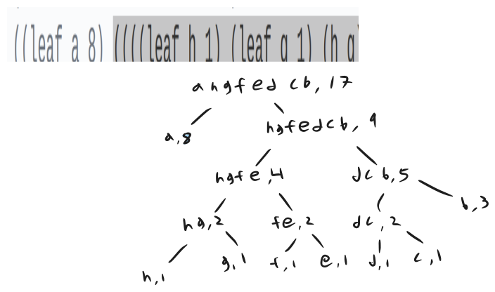

    <a href="notes-ch2-2.html">← Previous</a>
    <a href="../index.html">↑ Up</a>
    <a href="notes-ch2-4.html">Next →</a>

[HTML Book Chapter 2.3 Link](https://sarabander.github.io/sicp/html/2_002e3.xhtml#g_t2_002e3)

## Directory
- [Section 2.3](#section-23)
  - [Meeting 04-20-2025](#meeting-04-20-2025)
  - [Note on my confusion with Wolfram Language](#note-on-my-confusion-with-wolfram-language)
  - [Experimenting w/ derivatives](#experimenting-w-derivatives)
  - [Exercises](#exercises)
    - *Exercises:* ([Exercise 2.53](#exercise-253), [Exercise 2.54](#exercise-254), [Exercise 2.55](#exercise-255), [Exercise 2.56](#exercise-256), [Exercise 2.57](#exercise-257), [Exercise 2.58](#exercise-258), [Exercise 2.59](#exercise-259), [Exercise 2.60](#exercise-260), [Exercise 2.61](#exercise-261), [Exercise 2.62](#exercise-262), [Exercise 2.63](#exercise-263), [Exercise 2.64](#exercise-264), [Exercise 2.65](#exercise-265), [Exercise 2.66](#exercise-266), [Exercise 2.67](#exercise-267), [Exercise 2.68](#exercise-268), [Exercise 2.69](#exercise-269), [Exercise 2.70](#exercise-270), [Exercise 2.71](#exercise-271), [Exercise 2.72](#exercise-272))

## Section 2.3

### Meeting 04-20-2025

<pre>#lang sicp
;; true
(equal? &#39;(a b c) (list &#39;a &#39;b &#39;c))

;; false
(eq? &#39;(a b c) &#39;(a b c))

;; These three are equivalent: 
nil
&#39;()
(list)

;; These are ~equivalent ...?
&#39;(a b c)
(quote (a b c))
(list &#39;a &#39;b &#39;c)
(list (quote a) (quote b) (quote c))
</pre>

My solution to problem 2.54 was bad and had exceptions. Also, `symbol?` wasn't introduced until after this problem, so it really is probably not be the intended way.

<pre>#lang sicp

(define (equal? a b)
  (or (and (symbol? a) (symbol? b) (eq? a b))
      (and (null? a) (null? b))
      (and (pair? a) (pair? b) 
           (equal? (car a) (car b))
           (equal? (cdr a) (cdr b)))))

;;Some test cases:
(equal? &#39;(this is a list) 
        &#39;(this is a list))
(equal? &#39;(this is a list) 
        &#39;(this (is a) list))
(equal? &#39;(this (is a) list) 
        &#39;(this (is a) list))
(equal? &#39;a &#39;(a b c))

;; Failure case! 
(equal? (list 1 2 3) (list 1 2 3))
</pre>

Here was Erik's solution which might be a bit better or be the intended way:

<pre>(define (myequal? a b)
  (cond ((and (null? a) (null? b)) #t)
        ((or (null? a) (null? b)) #f)
        ((and (not (pair? a)) (not (pair? b))) (eq? a b))
        ((or (not (pair? a)) (not (pair? b))) #f)
        (else
         (and (myequal? (car a) (car b)) (myequal? (cdr a) (cdr b))))))
</pre>

More conversation about eq:

- "If obj1 and obj2 are both aggregate types, equal? compares its elements recursively."

- https://practical-scheme.net/gauche/man/gauche-refe/Equality-and-comparison.html

- https://www.gnu.org/software/guile/manual/html_node/Equality.html

- https://beautifulracket.com/explainer/equality.html

Back to the chapter:

 - Autodiff and problem 2.58. I found it interesting that the shunting yard algorithm wasn't used. Animation of the shunting yard algo: https://somethingorotherwhatever.com/shunting-yard-animation/

 - Guile is the GNU implementation of scheme. You could say scheme is a minimal lisp.

- https://github.com/zv/SICP-guile

 - For the proof of the optimality of huffman encoding, https://static.ias.edu/pitp/archive/2012files/Hamming_CHs1-3.pdf

 - https://norvig.com/ngrams/

 - https://news.ycombinator.com/item?id=13918465 - useful links in here! Some of the links are dead but can be accessed with internet archive.

 - https://www.youtube.com/watch?v=ZtTqRH1uwu4

### Note on my confusion with Wolfram Language

So far I have been able to identify WL expressions like `f[x,y]` 
with LISP expressions `(f x y)`. But this nice correspondence is slightly 
broken in this chapter. 

In Mathematica, `List[Quote[a],Quote[b],Quote[c]]` is different from `Quote[List[a,b,c]]` (you could compare them using `===`).

But in Scheme, it appears `(list 'a 'b 'c)` and `'(a b c)` are the same (compare with `equal?`).

If we had the perfect correspondence

`(f x y)` <=> `f[x,y]`

Then I would assume quoting might give something like this:

`'(f x y)` <=> `"f"["x","y"]` (because `"f[x,y]"` seems too boring)

But in fact it seems like the correspondence is more akin to:

`'(f x y)` <=> `List["f","x","y"]`.

This might be the first thing that is a strict difference in convention between WL and Lisp.

*Note to reader:* I'm not sure of this! Those are just my thoughts while learning.

<a href="code/ex2-53b.rkt">code/ex2-53b.rkt</a>

<pre>#lang racket

(define quoted-list &#39;(a b c))
(define list-of-quotes (list &#39;a &#39;b &#39;c))

(displayln &quot;Are (list &#39;a &#39;b &#39;c) and &#39;(a b c) structurally equal?&quot;)
(displayln (equal? (list &#39;a &#39;b &#39;c) &#39;(a b c))) ; =&gt; #t
(displayln (equal? (list (quote a) (quote b) (quote c)) 
                   (quote (a b c)))) ; =&gt; #t
</pre>

Output:
<pre>Are (list &#x27;a &#x27;b &#x27;c) and &#x27;(a b c) structurally equal?
#t
#t
</pre>

<a href="code/ex2-53b.wl">code/ex2-53b.wl</a>

<pre>expr1 = List[Quote[a],Quote[b],Quote[c]];
expr2 = Quote[List[a,b,c]];
expr1 === expr2
</pre>

Silly aside about @@:

<a href="code/ex2-53c.rkt">code/ex2-53c.rkt</a>

<pre>#lang sicp

(define (@@ f lst) 
  (cons f (cdr lst)))

(@@ &#39;g &#39;(f x y))
</pre>

Output:
<pre>(g x y)
</pre>

Tamwile in twitch chat says this is the equivalent in prolog:

<pre>% Request to prolog.
?- foo(X,Y) =.. [Head|Tail], New =.. [bar|Tail].
% Answer of prolog
   Head = foo, Tail = [X,Y], New = bar(X,Y).
</pre>

### Experimenting w/ derivatives

<a href="code/symbolic-deriv.rkt">code/symbolic-deriv.rkt</a>

<pre>#lang sicp

(define (variable? x) (symbol? x))
(define (same-variable? v1 v2)
  (and (variable? v1)
       (variable? v2)
       (eq? v1 v2)))

(define (make-sum a1 a2)
  (cond ((=number? a1 0) a2)
        ((=number? a2 0) a1)
        ((and (number? a1) (number? a2))
         (+ a1 a2))
        (else (list &#39;+ a1 a2))))
(define (make-product m1 m2)
  (cond ((or (=number? m1 0)
             (=number? m2 0))
         0)
        ((=number? m1 1) m2)
        ((=number? m2 1) m1)
        ((and (number? m1) (number? m2))
         (* m1 m2))
        (else (list &#39;* m1 m2))))
(define (=number? exp num)
  (and (number? exp) (= exp num)))

(define (sum? x)
  (and (pair? x) (eq? (car x) &#39;+)))
(define (addend s) (cadr s))
(define (augend s) (caddr s))

(define (product? x)
  (and (pair? x) (eq? (car x) &#39;*)))
(define (multiplier p) (cadr p))
(define (multiplicand p) (caddr p))

(define (exponentiation? x)
  (and (pair? x) (eq? (car x) &#39;**)))
(define (base x) (cadr x))
(define (exponent x) (caddr x))
(define (make-exponentiation a b) 
  (cond ((=number? b 0) 1)
        ((=number? b 1) a)
        ((=number? a 0) 0)
        (else (list &#39;** a b))))

 ;(list &#39;^ a b))

(define (deriv exp var)
  (cond ((number? exp) 0)
        ((variable? exp)
         (if (same-variable? exp var) 1 0))
        ((sum? exp)
         (make-sum (deriv (addend exp) var)
                   (deriv (augend exp) var)))
        ((product? exp)
         (make-sum
          (make-product
           (multiplier exp)
           (deriv (multiplicand exp) var))
          (make-product
           (deriv (multiplier exp) var)
           (multiplicand exp))))
        ((exponentiation? exp)
         (make-product
          (make-product
           (exponent exp)
           (make-exponentiation (base exp) (make-sum (exponent exp) -1)))
          (deriv (base exp) var)))
        (else (error &quot;unknown expression
                      type: DERIV&quot; exp))))
;; (1+a)*b*b
(deriv (make-product (make-product (make-sum 1 &#39;a) &#39;b) &#39;b) &#39;b)
;; (+ (* (+ 1 a) b) (* (+ 1 a) b))
;; = 2(1+a)b. Correct!

(deriv (make-exponentiation &#39;x 3) &#39;x)
(deriv (make-exponentiation &#39;x 2) &#39;x)
(deriv (make-exponentiation &#39;x 1) &#39;x)

;;d((y*(x+2))**2)/dx = 2y**2 * (x+2)
(deriv (make-exponentiation (make-product &#39;y (make-sum &#39;x 2)) 2) &#39;x)
</pre>

Output:
<pre>(+ (* (+ 1 a) b) (* (+ 1 a) b))
(* 3 (** x 2))
(* 2 x)
1
(* (* 2 (* y (+ x 2))) y)
</pre>

### Exercises

#### Exercise 2.53

What would the interpreter print
in response to evaluating each of the following expressions?

<pre>(list &#39;a &#39;b &#39;c)
(list (list &#39;george))
(cdr &#39;((x1 x2) (y1 y2)))
(cadr &#39;((x1 x2) (y1 y2)))
(pair? (car &#39;(a short list)))
(memq &#39;red &#39;((red shoes) (blue socks)))
(memq &#39;red &#39;(red shoes blue socks))
</pre>

##### Solution

<a href="code/ex2-53.rkt">code/ex2-53.rkt</a>

<pre>#lang sicp

(list &#39;a &#39;b &#39;c)
;; (a b c)

(list (list &#39;george))
;; ((george))

(cdr &#39;((x1 x2) (y1 y2)))
;; ((y1 y2)), a list with one element &#39;(y1 y2)

(cadr &#39;((x1 x2) (y1 y2)))
;; (y1 y2), the car of the previous result

(pair? (car &#39;(a short list)))
;; false, (car &#39;(a short list)) is just &#39;a

(memq &#39;red &#39;((red shoes) (blue socks)))
;; false, &#39;red is not a member of the list, &#39;(red shoes) is.

(memq &#39;red &#39;(red shoes blue socks))
;; (red shoes blue socks), the element is found so memq returns the list 
;; after and including &#39;red.
</pre>

Output:
<pre>(a b c)
((george))
((y1 y2))
(y1 y2)
#f
#f
(red shoes blue socks)
</pre>

#### Exercise 2.54

Two lists are said to be
`equal?` if they contain equal elements arranged in the same order.  For
example,

<pre>(equal? &#39;(this is a list) 
        &#39;(this is a list))
</pre>

is true, but

<pre>(equal? &#39;(this is a list) 
        &#39;(this (is a) list))
</pre>

is false.  To be more precise, we can define `equal?`  recursively in
terms of the basic `eq?` equality of symbols by saying that `a` and
`b` are `equal?` if they are both symbols and the symbols are
`eq?`, or if they are both lists such that `(car a)` is `equal?`
to `(car b)` and `(cdr a)` is `equal?` to `(cdr b)`.  Using
this idea, implement `equal?` as a procedure.

##### Solution

<a href="code/ex2-54.rkt">code/ex2-54.rkt</a>

<pre>#lang sicp

(define (equal? a b)
  (or (and (symbol? a) (symbol? b) (eq? a b))
      (and (null? a) (null? b))
      (and (pair? a) (pair? b) 
           (equal? (car a) (car b))
           (equal? (cdr a) (cdr b)))))

;;Some test cases:
(equal? &#39;(this is a list) 
        &#39;(this is a list))
(equal? &#39;(this is a list) 
        &#39;(this (is a) list))
(equal? &#39;(this (is a) list) 
        &#39;(this (is a) list))
(equal? &#39;a &#39;(a b c))

;; Failure case! 
(equal? (list 1 2 3) (list 1 2 3))
</pre>

Output:
<pre>#t
#f
#t
#f
#f
</pre>

This bugs me, because it will fail when comparing non-symbol lists like
`(equal? (list 1 2 3) (list 1 2 3))`. But we're doing what the problems says
so let's just move on.

#### Exercise 2.55

Eva Lu Ator types to the interpreter the expression

<pre>(car &#39;&#39;abracadabra)
</pre>

To her surprise, the interpreter prints back `quote`.  Explain.

##### Solution
We have `(quote (quote abracadabra))` in the inner expression.
The first quote is evaluated leaving the inner expression
`(list 'quote 'abracadabra)`. Of course the car of this is `'quote`!

#### Exercise 2.56

Show how to extend the basic
differentiator to handle more kinds of expressions.  For instance, implement
the differentiation rule

$${d(u^{\kern0.1ex n}) \over dx} \,=\, {nu^{\kern0.1ex n-1} \, {du \over dx}}  $$

by adding a new clause to the `deriv` program and defining appropriate
procedures `exponentiation?`, `base`, `exponent`, and
`make-exponentiation`.  (You may use the symbol `**` to denote
exponentiation.)  Build in the rules that anything raised to the power 0 is 1
and anything raised to the power 1 is the thing itself.

##### Solution

Differentiation with respect to something in the exponent will be incorrect silently! (We'd need logs)

<a href="code/ex2-56.rkt">code/ex2-56.rkt</a>

<pre>#lang sicp

(define (variable? x) (symbol? x))
(define (same-variable? v1 v2)
  (and (variable? v1)
       (variable? v2)
       (eq? v1 v2)))

(define (make-sum a1 a2)
  (cond ((=number? a1 0) a2)
        ((=number? a2 0) a1)
        ((and (number? a1) (number? a2))
         (+ a1 a2))
        (else (list &#39;+ a1 a2))))
(define (make-product m1 m2)
  (cond ((or (=number? m1 0)
             (=number? m2 0))
         0)
        ((=number? m1 1) m2)
        ((=number? m2 1) m1)
        ((and (number? m1) (number? m2))
         (* m1 m2))
        (else (list &#39;* m1 m2))))
(define (=number? exp num)
  (and (number? exp) (= exp num)))

(define (sum? x)
  (and (pair? x) (eq? (car x) &#39;+)))
(define (addend s) (cadr s))
(define (augend s) (caddr s))

(define (product? x)
  (and (pair? x) (eq? (car x) &#39;*)))
(define (multiplier p) (cadr p))
(define (multiplicand p) (caddr p))

(define (exponentiation? x)
  (and (pair? x) (eq? (car x) &#39;**)))
(define (base x) (cadr x))
(define (exponent x) (caddr x))
(define (make-exponentiation a b) 
  (cond ((=number? b 0) 1)
        ((=number? b 1) a)
        ((=number? a 0) 0)
        (else (list &#39;** a b))))

 ;(list &#39;^ a b))

(define (deriv exp var)
  (cond ((number? exp) 0)
        ((variable? exp)
         (if (same-variable? exp var) 1 0))
        ((sum? exp)
         (make-sum (deriv (addend exp) var)
                   (deriv (augend exp) var)))
        ((product? exp)
         (make-sum
          (make-product
           (multiplier exp)
           (deriv (multiplicand exp) var))
          (make-product
           (deriv (multiplier exp) var)
           (multiplicand exp))))
        ((exponentiation? exp)
         (make-product
          (make-product
           (exponent exp)
           (make-exponentiation (base exp) (make-sum (exponent exp) -1)))
          (deriv (base exp) var)))
        (else (error &quot;unknown expression
                      type: DERIV&quot; exp))))
(deriv (make-exponentiation &#39;x 3) &#39;x)
(deriv (make-exponentiation &#39;x 2) &#39;x)
(deriv (make-exponentiation &#39;x 1) &#39;x)

;;d((y*(x+2))**2)/dx = 2y**2 * (x+2)
(deriv (make-exponentiation (make-product &#39;y (make-sum &#39;x 2)) 2) &#39;x)
</pre>

Output:
<pre>(* 3 (** x 2))
(* 2 x)
1
(* (* 2 (* y (+ x 2))) y)
</pre>

#### Exercise 2.57

Extend the differentiation
program to handle sums and products of arbitrary numbers of (two or more)
terms.  Then the last example above could be expressed as

<pre>(deriv &#39;(* x y (+ x 3)) &#39;x)
</pre>

Try to do this by changing only the representation for sums and products,
without changing the `deriv` procedure at all.  For example, the
`addend` of a sum would be the first term, and the `augend` would be
the sum of the rest of the terms.

##### Solution

Some stuff we're not going to handle:

 - `make-sum` and `make-product` with multiple arguments and dotted tail notation,
 - Sorting expressions. ie without too much work we could automatically simplify
`(+ (* x 2) (* 2 y))` by sorting arguments and combining when equal.

<a href="code/ex2-57.rkt">code/ex2-57.rkt</a>

<pre>#lang sicp

(define (variable? x) (symbol? x))
(define (same-variable? v1 v2)
  (and (variable? v1)
       (variable? v2)
       (eq? v1 v2)))

(define (numorvar? x) (or (variable? x) (number? x)))

(define (make-sum a1 a2)
  (cond ((=number? a1 0) a2)
        ((=number? a2 0) a1)
        ((and (number? a1) (number? a2))
         (+ a1 a2))
        ((and (sum? a1) (numorvar? a2))
         (append a1 (list a2)))
        ((and (sum? a2) (numorvar? a1))
         (append (list &#39;+) (append (list a1) (cdr a2))))
        ((and (sum? a1) (sum? a2))
         (append a1 (cdr a2)))
        (else (list &#39;+ a1 a2))))
(define (make-product m1 m2)
  (cond ((or (=number? m1 0)
             (=number? m2 0))
         0)
        ((=number? m1 1) m2)
        ((=number? m2 1) m1)
        ((and (number? m1) (number? m2))
         (* m1 m2))
        ((and (product? m1) (numorvar? m2))
         (append m1 (list m2)))
        ((and (product? m2) (numorvar? m1))
         (append (list &#39;*) (append (list m1) (cdr m2))))
        ((and (product? m1) (product? m2))
         (append m1 (cdr m2)))
        (else (list &#39;* m1 m2))))
(define (=number? exp num)
  (and (number? exp) (= exp num)))

(define (sum? x)
  (and (pair? x) (eq? (car x) &#39;+)))
(define (addend s) (cadr s))
;; (define (augend s) (caddr s))
(define (augend s) 
  (let ((r (cddr s)))
    (if (&lt; 1 (length r))
      (append (list &#39;+) r)
      (car r))))

(define (product? x)
  (and (pair? x) (eq? (car x) &#39;*)))
(define (multiplier p) (cadr p))

;; Now this is going to return...
;;   A number if it&#39;s a list of length 2
;;   A (&#39;* p) if it&#39;s a longer list
(define (multiplicand p) 
  (let ((r (cddr p)))
    (if (&lt; 1 (length r))
      (append (list &#39;*) r)
      (car r))))

(define (deriv exp var)
  (cond ((number? exp) 0)
        ((variable? exp)
         (if (same-variable? exp var) 1 0))
        ((sum? exp)
         (make-sum (deriv (addend exp) var)
                   (deriv (augend exp) var)))
        ((product? exp)
         (make-sum
          (make-product
           (multiplier exp)
           (deriv (multiplicand exp) var))
          (make-product
           (deriv (multiplier exp) var)
           (multiplicand exp))))
        (else (error &quot;unknown expression
                      type: DERIV&quot; exp))))

(newline) (display &quot;make-product tests&quot;) (newline)
(make-product &#39;x &#39;y)
(make-product &#39;x (make-product &#39;y &#39;z))
(make-product 4 (make-product 2 &#39;x))
(make-product (make-product &#39;a &#39;x) (make-product 2 &#39;x))

(newline) (display &quot;make-sum tests&quot;) (newline)
(make-sum &#39;x &#39;y)
(make-sum &#39;x (make-sum &#39;y &#39;z))
(make-sum 4 (make-sum 2 &#39;x))
(make-sum (make-sum &#39;a &#39;x) (make-sum 2 &#39;x))

(newline) (display &quot;deriv and make-product tests&quot;) (newline)
(deriv (make-product &#39;x &#39;y) &#39;x)
(deriv (make-product &#39;x (make-product &#39;y &#39;z)) &#39;x)
(deriv (make-product 4 (make-product 2 &#39;x)) &#39;x)
(deriv (make-product (make-product &#39;a &#39;x) (make-product 2 &#39;x)) &#39;x)

(newline) (display &quot;sum and make-sum tests&quot;) (newline)
(deriv (make-sum &#39;x &#39;y) &#39;x)
(deriv (make-sum &#39;x (make-sum &#39;y &#39;z)) &#39;x)
(deriv (make-sum 4 (make-sum 2 &#39;x)) &#39;x)
(deriv (make-sum (make-sum &#39;a &#39;x) (make-sum 2 &#39;x)) &#39;x)
</pre>

Output:
<pre>
make-product tests
(* x y)
(* x y z)
(* 4 2 x)
(* a x 2 x)

make-sum tests
(+ x y)
(+ x y z)
(+ 4 2 x)
(+ a x 2 x)

deriv and make-product tests
y
(* y z)
8
(* a (+ (* x 2) (* 2 x)))

sum and make-sum tests
1
1
1
2
</pre>

#### Exercise 2.58

Suppose we want to modify the
differentiation program so that it works with ordinary mathematical notation,
in which `+` and `*` are infix rather than prefix operators.  Since
the differentiation program is defined in terms of abstract data, we can modify
it to work with different representations of expressions solely by changing the
predicates, selectors, and constructors that define the representation of the
algebraic expressions on which the differentiator is to operate.

**1.** Show how to do this in order to differentiate algebraic expressions presented
in infix form, such as `(x + (3 * (x + (y + 2))))`.  To simplify the task,
assume that `+` and `*` always take two arguments and that
expressions are fully parenthesized.

**2.** The problem becomes substantially harder if we allow standard algebraic
notation, such as `(x + 3 * (x + y + 2))`, which drops unnecessary
parentheses and assumes that multiplication is done before addition.  Can you
design appropriate predicates, selectors, and constructors for this notation
such that our derivative program still works?

##### Solution

For part 1, it's easy, we just have to adjust `make-***` and `augend,addend,multiplier,multiplicand`. 

<a href="code/ex2-58.rkt">code/ex2-58.rkt</a>

<pre>#lang sicp

(define (variable? x) (symbol? x))
(define (same-variable? v1 v2)
  (and (variable? v1)
       (variable? v2)
       (eq? v1 v2)))

(define (numorvar? x) (or (variable? x) (number? x)))

(define (make-sum a1 a2)
  (cond ((=number? a1 0) a2)
        ((=number? a2 0) a1)
        ((and (number? a1) (number? a2))
         (+ a1 a2))
        (else (list a1 &#39;+ a2))))
(define (make-product m1 m2)
  (cond ((or (=number? m1 0)
             (=number? m2 0))
         0)
        ((=number? m1 1) m2)
        ((=number? m2 1) m1)
        ((and (number? m1) (number? m2))
         (* m1 m2))
        (else (list m1 &#39;* m2))))
(define (=number? exp num)
  (and (number? exp) (= exp num)))

(define (sum? x)
  (and (pair? x) (eq? (cadr x) &#39;+)))
(define (addend s) (car s))
(define (augend s) (caddr s)) 

(define (product? x)
  (and (pair? x) (eq? (cadr x) &#39;*)))
(define (multiplier p) (car p))
(define (multiplicand p) (caddr p))

(define (deriv exp var)
  (cond ((number? exp) 0)
        ((variable? exp)
         (if (same-variable? exp var) 1 0))
        ((sum? exp)
         (make-sum (deriv (addend exp) var)
                   (deriv (augend exp) var)))
        ((product? exp)
         (make-sum
          (make-product
           (multiplier exp)
           (deriv (multiplicand exp) var))
          (make-product
           (deriv (multiplier exp) var)
           (multiplicand exp))))
        (else (error &quot;unknown expression
                      type: DERIV&quot; exp))))

(newline) (display &quot;make-product tests&quot;) (newline)
(make-product &#39;x &#39;y)
(make-product &#39;x (make-product &#39;y &#39;z))
(make-product 4 (make-product 2 &#39;x))
(make-product (make-product &#39;a &#39;x) (make-product 2 &#39;x))

(newline) (display &quot;make-sum tests&quot;) (newline)
(make-sum &#39;x &#39;y)
(make-sum &#39;x (make-sum &#39;y &#39;z))
(make-sum 4 (make-sum 2 &#39;x))
(make-sum (make-sum &#39;a &#39;x) (make-sum 2 &#39;x))

(newline) (display &quot;deriv and make-product tests&quot;) (newline)
(deriv (make-product &#39;x &#39;y) &#39;x)
(deriv (make-product &#39;x (make-product &#39;y &#39;z)) &#39;x)
(deriv (make-product 4 (make-product 2 &#39;x)) &#39;x)
(deriv (make-product (make-product &#39;a &#39;x) (make-product 2 &#39;x)) &#39;x)

(newline) (display &quot;sum and make-sum tests&quot;) (newline)
(deriv (make-sum &#39;x &#39;y) &#39;x)
(deriv (make-sum &#39;x (make-sum &#39;y &#39;z)) &#39;x)
(deriv (make-sum 4 (make-sum 2 &#39;x)) &#39;x)
(deriv (make-sum (make-sum &#39;a &#39;x) (make-sum 2 &#39;x)) &#39;x)
</pre>

Output:
<pre>
make-product tests
(x * y)
(x * (y * z))
(4 * (2 * x))
((a * x) * (2 * x))

make-sum tests
(x + y)
(x + (y + z))
(4 + (2 + x))
((a + x) + (2 + x))

deriv and make-product tests
y
(y * z)
8
(((a * x) * 2) + (a * (2 * x)))

sum and make-sum tests
1
1
1
2
</pre>

For part 2, we can definitely just modify the accessors to get the correct results.

<a href="code/ex2-58b.rkt">code/ex2-58b.rkt</a>

<pre>#lang sicp

(define (variable? x) (symbol? x))
(define (same-variable? v1 v2)
  (and (variable? v1)
       (variable? v2)
       (eq? v1 v2)))

(define (numorvar? x) (or (variable? x) (number? x)))

(define (make-sum a1 a2)
  (cond ((=number? a1 0) a2)
        ((=number? a2 0) a1)
        ((and (number? a1) (number? a2))
         (+ a1 a2))
        (else (list a1 &#39;+ a2))))
(define (make-product m1 m2)
  (cond ((or (=number? m1 0)
             (=number? m2 0))
         0)
        ((=number? m1 1) m2)
        ((=number? m2 1) m1)
        ((and (number? m1) (number? m2))
         (* m1 m2))
        (else (list m1 &#39;* m2))))
(define (=number? exp num)
  (and (number? exp) (= exp num)))

;; Return false if element doesn&#39;t exist
;; Return list otherwise.
(define (take-after elem lst)
  (let ((rst (memq elem lst)))
    (if (eq? rst #f) rst (cdr rst))))

;; Return false if element doesn&#39;t exist
;; Return list otherwise.
(define (take-before elem lst)
  (cond ((null? lst) #f)
        ((eq? (car lst) elem) nil)
        (else (let ((rst (take-before elem (cdr lst))))
                (if (not rst) 
                  rst 
                  (cons (car lst) rst))))))

;; True if a &#39;+ exists in our expression.
(define (sum? x)
  (and (pair? x) (not (eq? (memq &#39;+ x) #f))))
;; Take from the first symbol, up to but excluding &#39;+
(define (addend s)
  (let ((rst (take-before &#39;+ s)))
    (if (&lt; 1 (length rst)) rst (car rst))))
;; Exclude the first terms up to &#39;+ and return the rest (?)
(define (augend s) 
  (let ((rst (take-after &#39;+ s)))
    (if (&lt; 1 (length rst)) rst (car rst))))
;; True if no &#39;+ exists in our expression, but &#39;* does.
(define (product? x)
  (and (pair? x) 
       (not (sum? x)) 
       (not (eq? (memq &#39;* x) #f))))
;; take up to and excluding the first &#39;*
(define (multiplier p) 
  (let ((rst (take-before &#39;* p)))
    (if (&lt; 1 (length rst)) rst (car rst))))
;; Get the rest after the first &#39;*
(define (multiplicand p) 
  (let ((rst (take-after &#39;* p)))
    (if (&lt; 1 (length rst)) rst (car rst))))

(define (deriv exp var)
  (cond ((number? exp) 0)
        ((variable? exp)
         (if (same-variable? exp var) 1 0))
        ((sum? exp)
         (make-sum (deriv (addend exp) var)
                   (deriv (augend exp) var)))
        ((product? exp)
         (make-sum
          (make-product
           (multiplier exp)
           (deriv (multiplicand exp) var))
          (make-product
           (deriv (multiplier exp) var)
           (multiplicand exp))))
        (else (error &quot;unknown expression
                      type: DERIV&quot; exp))))

(newline) (display &quot;make-product tests&quot;) (newline)
(make-product &#39;x &#39;y)
(make-product &#39;x (make-product &#39;y &#39;z))
(make-product 4 (make-product 2 &#39;x))
(make-product (make-product &#39;a &#39;x) (make-product 2 &#39;x))

(newline) (display &quot;make-sum tests&quot;) (newline)
(make-sum &#39;x &#39;y)
(make-sum &#39;x (make-sum &#39;y &#39;z))
(make-sum 4 (make-sum 2 &#39;x))
(make-sum (make-sum &#39;a &#39;x) (make-sum 2 &#39;x))

(newline) (display &quot;deriv and make-product tests&quot;) (newline)
(deriv (make-product &#39;x &#39;y) &#39;x)
(deriv (make-product &#39;x (make-product &#39;y &#39;z)) &#39;x)
(deriv (make-product 4 (make-product 2 &#39;x)) &#39;x)
(deriv (make-product (make-product &#39;a &#39;x) (make-product 2 &#39;x)) &#39;x)

(newline) (display &quot;sum and make-sum tests&quot;) (newline)
(deriv (make-sum &#39;x &#39;y) &#39;x)
(deriv (make-sum &#39;x (make-sum &#39;y &#39;z)) &#39;x)
(deriv (make-sum 4 (make-sum 2 &#39;x)) &#39;x)
(deriv (make-sum (make-sum &#39;a &#39;x) (make-sum 2 &#39;x)) &#39;x)

(newline) (display &quot;Another example&quot;) (newline)
(deriv &#39;(x + 3 * (x * x + y + 2)) &#39;x)
(deriv &#39;(x + 3 * (x * x + y + 2)) &#39;y)
</pre>

Output:
<pre>
make-product tests
(x * y)
(x * (y * z))
(4 * (2 * x))
((a * x) * (2 * x))

make-sum tests
(x + y)
(x + (y + z))
(4 + (2 + x))
((a + x) + (2 + x))

deriv and make-product tests
y
(y * z)
8
(((a * x) * 2) + (a * (2 * x)))

sum and make-sum tests
1
1
1
2

Another example
(1 + (3 * (x + x)))
3
</pre>

<!-- For part 2, One way we can easily do this is: On the top level of a list, make a list of all summands and recurse `(deriv term sym)`. If there are no sums. make a list of all products and recurse in the more complicated product rule form. -->

#### Exercise 2.59

Implement the `union-set`
operation for the unordered-list representation of sets.

##### Solution

My impl reverses the order of elements, which is ugly, but whatever.

<a href="code/ex2-59.rkt">code/ex2-59.rkt</a>

<pre>#lang sicp

(define (element-of-set? x set)
  (cond ((null? set) false)
        ((equal? x (car set)) true)
        (else (element-of-set? x (cdr set)))))

(define (adjoin-set x set)
  (if (element-of-set? x set)
      set
      (cons x set)))

(define (intersection-set set1 set2)
  (cond ((or (null? set1) (null? set2)) 
         &#39;())
        ((element-of-set? (car set1) set2)
         (cons (car set1)
               (intersection-set (cdr set1) 
                                 set2)))
        (else (intersection-set (cdr set1) 
                                set2))))
(define (union-set gset1 gset2)
  (define (union-set-helper set1 set2 ret)
    (cond ((and (null? set1) (null? set2)) ret)
        ((null? set1) (union-set-helper set2 set1 ret))
        (else (if (element-of-set? (car set1) ret)
                  (union-set-helper (cdr set1) set2 ret)
                  (union-set-helper (cdr set1) set2 (cons (car set1) ret))))))
  (union-set-helper gset1 gset2 &#39;()))

(define set1 &#39;(a b c d e f))
(define set2 &#39;(c d e f g h i))

(intersection-set set1 set2)
(union-set set1 set2)
</pre>

Output:
<pre>(c d e f)
(i h g f e d c b a)
</pre>

#### Exercise 2.60

We specified that a set would be
represented as a list with no duplicates.  Now suppose we allow duplicates.
For instance, the set $\{1, 2, 3\}$ could be represented as the list `(2 3 2 1
3 2 2)`.  Design procedures `element-of-set?`, `adjoin-set`,
`union-set`, and `intersection-set` that operate on this
representation.  How does the efficiency of each compare with the corresponding
procedure for the non-duplicate representation?  Are there applications for
which you would use this representation in preference to the non-duplicate one?

##### Solution

<a href="code/ex2-60.rkt">code/ex2-60.rkt</a>

<pre>#lang sicp

(define (element-of-set? x set)
  (cond ((null? set) false)
        ((equal? x (car set)) true)
        (else (element-of-set? x (cdr set)))))

; Theta(1)
(define (adjoin-set x set)
  (cons x set))
  
;; Theta(n^2)
(define (intersection-set set1 set2)
  (cond ((or (null? set1) (null? set2)) 
         &#39;())
        ((element-of-set? (car set1) set2)
         (cons (car set1)
               (intersection-set (cdr set1) 
                                 set2)))
        (else (intersection-set (cdr set1) 
                                set2))))

;; Theta(1) (or, if append is implemented with (length gset1) calls to cons, it&#39;s Theta(n))
(define (union-set gset1 gset2)
  (append gset1 gset2))

(define set1 &#39;(a b c d e f))
(define set2 &#39;(c d e f g h i))

(intersection-set set1 set2)
(union-set set1 set2)
</pre>

Output:
<pre>(c d e f)
(a b c d e f c d e f g h i)
</pre>

#### Exercise 2.61

Give an implementation of
`adjoin-set` using the ordered representation.  By analogy with
`element-of-set?` show how to take advantage of the ordering to produce a
procedure that requires on the average about half as many steps as with the
unordered representation.

##### Solution

<a href="code/ex2-61.rkt">code/ex2-61.rkt</a>

<pre>#lang sicp

(define (adjoin-set x set)
  (cond ((null? set) (list x))
        ((&gt; x (car set)) 
         (cons (car set) (adjoin-set x (cdr set))))
        ((= x (car set)) set)
        (else (cons x set))))

(define set0 (list 0 4 8 12))

(adjoin-set 4 set0)
(adjoin-set 5 set0)
(adjoin-set 1 set0)
(adjoin-set -1 set0)
(adjoin-set 16 set0)
</pre>

Output:
<pre>(0 4 8 12)
(0 4 5 8 12)
(0 1 4 8 12)
(-1 0 4 8 12)
(0 4 8 12 16)
</pre>

#### Exercise 2.62

Give a $\Theta(n)$
implementation of `union-set` for sets represented as ordered lists.

##### Solution

<a href="code/ex2-62.rkt">code/ex2-62.rkt</a>

<pre>#lang sicp

(define (element-of-set? x set)
  (cond ((null? set) false)
        ((= x (car set)) true)
        ((&lt; x (car set)) false)
        (else (element-of-set? x (cdr set)))))

(define (adjoin-set x set)
  (cond ((null? set) (list x))
        ((&gt; x (car set)) 
         (cons (car set) (adjoin-set x (cdr set))))
        ((= x (car set)) set)
        (else (cons x set))))

(define (intersection-set set1 set2)
  (if (or (null? set1) (null? set2))
      &#39;()
      (let ((x1 (car set1)) (x2 (car set2)))
        (cond ((= x1 x2)
               (cons x1 (intersection-set
                         (cdr set1)
                         (cdr set2))))
              ((&lt; x1 x2) (intersection-set
                          (cdr set1)
                          set2))
              ((&lt; x2 x1) (intersection-set
                          set1
                          (cdr set2)))))))

;; set1 is an ordered set, set2 is an ordered set,
;; both with no duplicates
(define (union-set set1 set2)
  (cond ((null? set1) set2)
        ((null? set2) set1)
        (else (let ((x1 (car set1)) (x2 (car set2)))
          (cond ((= x1 x2)
                 (cons x1 (union-set
                           (cdr set1)
                           (cdr set2))))
                ((&lt; x1 x2) 
                 (cons x1 (union-set 
                            (cdr set1)
                            set2)))
                ((&lt; x2 x1) 
                 (cons x2 (union-set
                            set1
                            (cdr set2)))))))))

(define set0 (list 0 4 8 12))
(define set1 (list -4 -3 0 1 4))
(define set2 (list 16 18 20))

(intersection-set set0 set1)
(union-set set0 set1)
(union-set set1 set0)
(union-set set1 set2)
(union-set set2 set1)
</pre>

Output:
<pre>(0 4)
(-4 -3 0 1 4 8 12)
(-4 -3 0 1 4 8 12)
(-4 -3 0 1 4 16 18 20)
(-4 -3 0 1 4 16 18 20)
</pre>

#### Exercise 2.63

Each of the following two
procedures converts a binary tree to a list.

<pre>(define (tree-&gt;list-1 tree)
  (if (null? tree)
      &#39;()
      (append 
       (tree-&gt;list-1 
        (left-branch tree))
       (cons (entry tree)
             (tree-&gt;list-1 
              (right-branch tree))))))

(define (tree-&gt;list-2 tree)
  (define (copy-to-list tree result-list)
    (if (null? tree)
        result-list
        (copy-to-list 
         (left-branch tree)
         (cons (entry tree)
               (copy-to-list 
                (right-branch tree)
                result-list)))))
  (copy-to-list tree &#39;()))
</pre>

**1.** Do the two procedures produce the same result for every tree?  If not, how do
the results differ?  What lists do the two procedures produce for the trees in
Figure 2.16?

**2.** Do the two procedures have the same order of growth in the number of steps
required to convert a balanced tree with $n$ elements to a list?  If not,
which one grows more slowly?

##### Solution

An animation of these algorithms would be nice!

1. They both produce the same result for every tree. The implementation below constructs
the different trees and demonstrates this.
2. The two procedures don't have the same order of growth. The second algorithm is $\Theta(n)$ where $n$ is the number of nodes. The issue with the first algorithm is the append operation,
which first has to traverse a linked list before appending the second list. This sets up a bit 
of a weird recursion. For a perfectly balanced tree, I first thought this is $\Theta(n^2)$ where
$n$ is the number of nodes, but in fact it's $\Theta(n\log(n))$. We can set up a recursion:

The time taken for a tree, $T(\text{tree})$ is the sum of...

 - the time taken to append the left tree, $\textrm{Length}(\textrm{left-tree})$
 - the time taken to construct the left tree, $T(\textrm{left-tree})$
 - the time taken to construct the right tree, $T(\textrm{right-tree})$

So 
$$T(\textrm{tree})=\textrm{Length}(\textrm{left-tree})+T(\textrm{left-tree})+T(\textrm{right-tree})$$

For a perfectly balanced tree of length n, this gives recursion
$$T(n)=\frac{n}{2}+2T(\frac{n}{2})$$
Whose solution is $T(n)=\Theta(n\log(n))$

<a href="code/ex2-63.rkt">code/ex2-63.rkt</a>

<pre>#lang sicp

(define (entry tree) (car tree))
(define (left-branch tree) (cadr tree))
(define (right-branch tree) (caddr tree))
(define (make-tree entry left right)
  (list entry left right))
;; trivial tree
(define (tt entry)
  (list entry &#39;() &#39;()))

(define one (tt 1))
(define three (tt 3))
(define five (tt 5))
(define seven (tt 7))
(define nine (tt 9))
(define eleven (tt 11))
(define tree-one (make-tree 7 (make-tree 3 one five) (make-tree 9 &#39;() eleven)))
(define tree-two (make-tree 3 one (make-tree 7 five (make-tree 9 &#39;() eleven))))
(define tree-three (make-tree 5 (make-tree 3 one &#39;()) (make-tree 9 seven eleven)))

(define (element-of-set? x set)
  (cond ((null? set) false)
        ((= x (entry set)) true)
        ((&lt; x (entry set))
         (element-of-set? 
          x 
          (left-branch set)))
        ((&gt; x (entry set))
         (element-of-set? 
          x 
          (right-branch set)))))

(define (adjoin-set x set)
  (cond ((null? set) (make-tree x &#39;() &#39;()))
        ((= x (entry set)) set)
        ((&lt; x (entry set))
         (make-tree
          (entry set)
          (adjoin-set x (left-branch set))
          (right-branch set)))
        ((&gt; x (entry set))
         (make-tree
          (entry set)
          (left-branch set)
          (adjoin-set x (right-branch set))))))

;; Each time we do an append we have to traverse a linked list, 
;; which is of length n, so I think

;; If it&#39;s a balanced tree, at step 1 we do (n/2) steps
;; T(tree) = Length(left-tree) + T(left-tree)+ 1 + T(right-tree)
;; T(N) = N/2 + 2 T(N/2) + 1
(define (tree-&gt;list-1 tree)
  (if (null? tree)
      &#39;()
      (append 
       (tree-&gt;list-1 
        (left-branch tree))
       (cons (entry tree)
             (tree-&gt;list-1 
              (right-branch tree))))))

;; Theta(# of nodes?)
(define (tree-&gt;list-2 tree)
  ;; Invariant: tree &lt; result-list (for all elements)
  (define (copy-to-list tree result-list)
    (if (null? tree)
        result-list
        (copy-to-list 
         (left-branch tree)
         (cons (entry tree)
               (copy-to-list 
                (right-branch tree)
                result-list)))))
  (copy-to-list tree &#39;()))

(tree-&gt;list-1 tree-one)
(tree-&gt;list-2 tree-one)
(tree-&gt;list-1 tree-two)
(tree-&gt;list-2 tree-two)
(tree-&gt;list-1 tree-three)
(tree-&gt;list-2 tree-three)
</pre>

Output:
<pre>(1 3 5 7 9 11)
(1 3 5 7 9 11)
(1 3 5 7 9 11)
(1 3 5 7 9 11)
(1 3 5 7 9 11)
(1 3 5 7 9 11)
</pre>

#### Exercise 2.64

The following procedure
`list->tree` converts an ordered list to a balanced binary tree.  The
helper procedure `partial-tree` takes as arguments an integer $n$ and
list of at least $n$ elements and constructs a balanced tree containing the
first $n$ elements of the list.  The result returned by `partial-tree`
is a pair (formed with `cons`) whose `car` is the constructed tree
and whose `cdr` is the list of elements not included in the tree.

<pre>(define (list-&gt;tree elements)
  (car (partial-tree 
        elements (length elements))))

(define (partial-tree elts n)
  (if (= n 0)
      (cons &#39;() elts)
      (let ((left-size 
             (quotient (- n 1) 2)))
        (let ((left-result 
               (partial-tree 
                elts left-size)))
          (let ((left-tree 
                 (car left-result))
                (non-left-elts 
                 (cdr left-result))
                (right-size 
                 (- n (+ left-size 1))))
            (let ((this-entry 
                   (car non-left-elts))
                  (right-result 
                   (partial-tree 
                    (cdr non-left-elts)
                    right-size)))
              (let ((right-tree 
                     (car right-result))
                    (remaining-elts 
                     (cdr right-result)))
                (cons (make-tree this-entry 
                                 left-tree 
                                 right-tree)
                      remaining-elts))))))))
</pre>

**1.** Write a short paragraph explaining as clearly as you can how
`partial-tree` works.  Draw the tree produced by `list->tree` for
the list `(1 3 5 7 9 11)`.

**2.** What is the order of growth in the number of steps required by
`list->tree` to convert a list of $n$ elements?

##### Solution

The key is that we want to be able to write this line:

<pre>(cons (make-tree this-entry
       left-tree
       right-tree)
 remaining-elts)
</pre>

In Javascript we'd use something like `.slice()` to get the first ~n/2
elements, the middle element, and the last ~n/2 elements. The purpose of the 
remaining-elts list basically implements this slicing in a clever way.

For question 2, we don't have any calls to things like `length` or `append` 
in our recursion. So our growth should just be linear.

#### Exercise 2.65

Use the results of Exercise 2.63 
and Exercise 2.64 to give $\Theta(n)$ implementations of
`union-set` and `intersection-set` for sets implemented as (balanced)
binary trees.

##### Solution

We can just combine our previous algorithms:

<pre>(define (union-set-tree set1 set2)
  (list-&gt;tree (union-set
               (tree-&gt;list set1) 
               (tree-&gt;list set2))))
(define (intersection-set-tree set1 set2)
  (list-&gt;tree (intersection-set 
               (tree-&gt;list set1)
               (tree-&gt;list set2))))
</pre>

#### Exercise 2.66

Implement the `lookup`
procedure for the case where the set of records is structured as a binary tree,
ordered by the numerical values of the keys.

##### Solution

We'll assume we have the same functions like `entry, left-branch, right-branch`.

<pre>(define (lookup given-key records)
  (cond ((null? records) false)
        ((= given-key (key (entry records))) (entry record))
        ((&lt; given-key (key (entry records)))
         (lookup given-key (left-branch records)))
        ((&gt; given-key (key (entry records)))
         (lookup given-key (key (right-branch records))))))
</pre>

#### Exercise 2.67

Define an encoding tree and a
sample message:

<pre>(define sample-tree
  (make-code-tree 
   (make-leaf &#39;A 4)
   (make-code-tree
    (make-leaf &#39;B 2)
    (make-code-tree 
     (make-leaf &#39;D 1)
     (make-leaf &#39;C 1)))))

(define sample-message 
  &#39;(0 1 1 0 0 1 0 1 0 1 1 1 0))
</pre>

Use the `decode` procedure to decode the message, and give the result.

##### Solution

`(A D A B B C A)`

<a href="code/ex2-67.rkt">code/ex2-67.rkt</a>

<pre>#lang sicp
(define (make-leaf symbol weight)
  (list &#39;leaf symbol weight))
(define (leaf? object)
  (eq? (car object) &#39;leaf))
(define (symbol-leaf x) (cadr x))
(define (weight-leaf x) (caddr x))

(define (left-branch tree) (car tree))
(define (right-branch tree) (cadr tree))

(define (symbols tree)
  (if (leaf? tree)
      (list (symbol-leaf tree))
      (caddr tree)))

(define (weight tree)
  (if (leaf? tree)
      (weight-leaf tree)
      (cadddr tree)))

(define (make-code-tree left right)
  (list left
        right
        (append (symbols left)
                (symbols right))
        (+ (weight left) (weight right))))

(define (decode bits tree)
  (define (decode-1 bits current-branch)
    (if (null? bits)
        &#39;()
        (let ((next-branch
               (choose-branch
                (car bits)
                current-branch)))
          (if (leaf? next-branch)
              (cons
               (symbol-leaf next-branch)
               (decode-1 (cdr bits) tree))
              (decode-1 (cdr bits)
                        next-branch)))))
  (decode-1 bits tree))

(define (choose-branch bit branch)
  (cond ((= bit 0) (left-branch branch))
        ((= bit 1) (right-branch branch))
        (else (error &quot;bad bit:
               CHOOSE-BRANCH&quot; bit))))

(define (adjoin-set x set)
  (cond ((null? set) (list x))
        ((&lt; (weight x) (weight (car set))) 
         (cons x set))
        (else 
         (cons (car set)
               (adjoin-set x (cdr set))))))

(define (make-leaf-set pairs)
  (if (null? pairs)
      &#39;()
      (let ((pair (car pairs)))
        (adjoin-set 
         (make-leaf (car pair)    ; symbol
                    (cadr pair))  ; frequency
         (make-leaf-set (cdr pairs))))))

(define sample-tree
  (make-code-tree 
   (make-leaf &#39;A 4)
   (make-code-tree
    (make-leaf &#39;B 2)
    (make-code-tree 
     (make-leaf &#39;D 1)
     (make-leaf &#39;C 1)))))

(define sample-message 
  &#39;(0 1 1 0 0 1 0 1 0 1 1 1 0))

(decode sample-message sample-tree)
</pre>

Output:
<pre>(A D A B B C A)
</pre>

#### Exercise 2.68

The `encode` procedure takes
as arguments a message and a tree and produces the list of bits that gives the
encoded message.

<pre>(define (encode message tree)
  (if (null? message)
      &#39;()
      (append 
       (encode-symbol (car message) 
                      tree)
       (encode (cdr message) tree))))
</pre>

`Encode-symbol` is a procedure, which you must write, that returns the
list of bits that encodes a given symbol according to a given tree.  You should
design `encode-symbol` so that it signals an error if the symbol is not in
the tree at all.  Test your procedure by encoding the result you obtained in
Exercise 2.67 with the sample tree and seeing whether it is the same as
the original sample message.

##### Solution

Encoding the decoded message returns the correct thing.

<a href="code/ex2-68.rkt">code/ex2-68.rkt</a>

<pre>#lang sicp

(define (make-leaf symbol weight)
  (list &#39;leaf symbol weight))
(define (leaf? object)
  (eq? (car object) &#39;leaf))

(define (symbol-leaf x) (cadr x))
(define (weight-leaf x) (caddr x))

(define (left-branch tree) (car tree))
(define (right-branch tree) (cadr tree))

(define (symbols tree)
  (if (leaf? tree)
      (list (symbol-leaf tree))
      (caddr tree)))

(define (weight tree)
  (if (leaf? tree)
      (weight-leaf tree)
      (cadddr tree)))

(define (element-of-list? x lst)
  (cond ((null? lst) false)
        ((equal? x (car lst)) true)
        (else (element-of-list? x (cdr lst)))))

(define (make-code-tree left right)
  (list left
        right
        (append (symbols left)
                (symbols right))
        (+ (weight left) (weight right))))

(define (decode bits tree)
  (define (decode-1 bits current-branch)
    (if (null? bits)
        &#39;()
        (let ((next-branch
               (choose-branch
                (car bits)
                current-branch)))
          (if (leaf? next-branch)
              (cons
               (symbol-leaf next-branch)
               (decode-1 (cdr bits) tree))
              (decode-1 (cdr bits)
                        next-branch)))))
  (decode-1 bits tree))

(define (choose-branch bit branch)
  (cond ((= bit 0) (left-branch branch))
        ((= bit 1) (right-branch branch))
        (else (error &quot;bad bit:
               CHOOSE-BRANCH&quot; bit))))

(define (adjoin-set x set)
  (cond ((null? set) (list x))
        ((&lt; (weight x) (weight (car set))) 
         (cons x set))
        (else 
         (cons (car set)
               (adjoin-set x (cdr set))))))

(define (make-leaf-set pairs)
  (if (null? pairs)
      &#39;()
      (let ((pair (car pairs)))
        (adjoin-set 
         (make-leaf (car pair)    ; symbol
                    (cadr pair))  ; frequency
         (make-leaf-set (cdr pairs))))))

(define sample-tree
  (make-code-tree 
   (make-leaf &#39;A 4)
   (make-code-tree
    (make-leaf &#39;B 2)
    (make-code-tree 
     (make-leaf &#39;D 1)
     (make-leaf &#39;C 1)))))

(define sample-message 
  &#39;(0 1 1 0 0 1 0 1 0 1 1 1 0))

(define (encode message tree)
  (if (null? message)
      &#39;()
      (append 
       (encode-symbol (car message) 
                      tree)
       (encode (cdr message) tree))))

(define (encode-symbol symbol tree)
  (cond
    ((leaf? tree) 
                (if 
                  (equal? (symbol-leaf tree) symbol) &#39;() 
                  (error &quot;symbol not in tree &quot; symbol)))
    ((element-of-list? symbol (symbols (left-branch tree))) 
                    (cons &#39;0 (encode-symbol symbol (left-branch tree))))
    ((element-of-list? symbol (symbols (right-branch tree))) 
                    (cons &#39;1 (encode-symbol symbol (right-branch tree))))
    (else (error &quot;symbol not in tree&quot; symbol))))

sample-message

(decode sample-message sample-tree)

(encode &#39;(A D A B B C A) sample-tree)
</pre>

Output:
<pre>(0 1 1 0 0 1 0 1 0 1 1 1 0)
(A D A B B C A)
(0 1 1 0 0 1 0 1 0 1 1 1 0)
</pre>

#### Exercise 2.69

The following procedure takes as
its argument a list of symbol-frequency pairs (where no symbol appears in more
than one pair) and generates a Huffman encoding tree according to the Huffman
algorithm.

<pre>(define (generate-huffman-tree pairs)
  (successive-merge 
   (make-leaf-set pairs)))
</pre>

`Make-leaf-set` is the procedure given above that transforms the list of
pairs into an ordered set of leaves.  `Successive-merge` is the procedure
you must write, using `make-code-tree` to successively merge the
smallest-weight elements of the set until there is only one element left, which
is the desired Huffman tree.  (This procedure is slightly tricky, but not
really complicated.  If you find yourself designing a complex procedure, then
you are almost certainly doing something wrong.  You can take significant
advantage of the fact that we are using an ordered set representation.)

##### Solution

<a href="code/ex2-69.rkt">code/ex2-69.rkt</a>

<pre>#lang sicp

(define (make-leaf symbol weight)
  (list &#39;leaf symbol weight))
(define (leaf? object)
  (eq? (car object) &#39;leaf))

(define (symbol-leaf x) (cadr x))
(define (weight-leaf x) (caddr x))

(define (left-branch tree) (car tree))
(define (right-branch tree) (cadr tree))

(define (symbols tree)
  (if (leaf? tree)
      (list (symbol-leaf tree))
      (caddr tree)))

(define (weight tree)
  (if (leaf? tree)
      (weight-leaf tree)
      (cadddr tree)))

(define (element-of-list? x lst)
  (cond ((null? lst) false)
        ((equal? x (car lst)) true)
        (else (element-of-list? x (cdr lst)))))

(define (make-code-tree left right)
  (list left
        right
        (append (symbols left)
                (symbols right))
        (+ (weight left) (weight right))))

(define (decode bits tree)
  (define (decode-1 bits current-branch)
    (if (null? bits)
        &#39;()
        (let ((next-branch
               (choose-branch
                (car bits)
                current-branch)))
          (if (leaf? next-branch)
              (cons
               (symbol-leaf next-branch)
               (decode-1 (cdr bits) tree))
              (decode-1 (cdr bits)
                        next-branch)))))
  (decode-1 bits tree))

(define (choose-branch bit branch)
  (cond ((= bit 0) (left-branch branch))
        ((= bit 1) (right-branch branch))
        (else (error &quot;bad bit:
               CHOOSE-BRANCH&quot; bit))))

(define (adjoin-set x set)
  (cond ((null? set) (list x))
        ((&lt; (weight x) (weight (car set))) 
         (cons x set))
        (else 
         (cons (car set)
               (adjoin-set x (cdr set))))))

(define (make-leaf-set pairs)
  (if (null? pairs)
      &#39;()
      (let ((pair (car pairs)))
        (adjoin-set 
         (make-leaf (car pair)    ; symbol
                    (cadr pair))  ; frequency
         (make-leaf-set (cdr pairs))))))

(define sample-tree
  (make-code-tree 
   (make-leaf &#39;A 4)
   (make-code-tree
    (make-leaf &#39;B 2)
    (make-code-tree 
     (make-leaf &#39;D 1)
     (make-leaf &#39;C 1)))))

(define sample-message 
  &#39;(0 1 1 0 0 1 0 1 0 1 1 1 0))

(define (encode message tree)
  (if (null? message)
      &#39;()
      (append 
       (encode-symbol (car message) 
                      tree)
       (encode (cdr message) tree))))

(define (encode-symbol symbol tree)
  (cond
    ((leaf? tree) 
                (if 
                  (equal? (symbol-leaf tree) symbol) &#39;() 
                  (error &quot;symbol not in tree &quot; symbol)))
    ((element-of-list? symbol (symbols (left-branch tree))) 
                    (cons &#39;0 (encode-symbol symbol (left-branch tree))))
    ((element-of-list? symbol (symbols (right-branch tree))) 
                    (cons &#39;1 (encode-symbol symbol (right-branch tree))))
    (else (error &quot;symbol not in tree&quot; symbol))))

(define (generate-huffman-tree pairs)
  (successive-merge
   (make-leaf-set pairs)))

    ;; merge the symbols of the first two elements of the list
    ;; add the weights
    ;; make the tree
(define (successive-merge tree-list) 
  (if (= 1 (length tree-list)) (car tree-list)
    (let ((a (car tree-list)) 
          (b (cadr tree-list)) 
          (rest (cddr tree-list)))
      (successive-merge (adjoin-set (make-code-tree a b) rest)))))

sample-message

(decode sample-message sample-tree)

(encode &#39;(A D A B B C A) sample-tree)

(generate-huffman-tree &#39;((a 8) (b 3) (c 1) (d 1) (e 1) (f 1) (g 1) (h 1)))
</pre>

Output:
<pre>(0 1 1 0 0 1 0 1 0 1 1 1 0)
(A D A B B C A)
(0 1 1 0 0 1 0 1 0 1 1 1 0)
((leaf a 8) ((((leaf h 1) (leaf g 1) (h g) 2) ((leaf f 1) (leaf e 1) (f e) 2) (h g f e) 4) (((leaf d 1) (leaf c 1) (d c) 2) (leaf b 3) (d c b) 5) (h g f e d c b) 9) (a h g f e d c b) 17)
</pre>

After staring long enough, this tree is not quite the same as the one given earlier in the chapter (for example `b` is encoded as `111` instead of `100`), but that's fine.

  

#### Exercise 2.70
The following eight-symbol
alphabet with associated relative frequencies was designed to efficiently
encode the lyrics of 1950s rock songs.  (Note that the ``symbols'' of an
``alphabet'' need not be individual letters.)

<table>
  <tr><td>A</td><td>2</td><td>NA</td><td>16</td></tr>
  <tr><td>BOOM</td><td>1</td><td>SHA</td><td>3</td></tr>
  <tr><td>GET</td><td>2</td><td>YIP</td><td>9</td></tr>
  <tr><td>JOB</td><td>2</td><td>WAH</td><td>1</td></tr>
</table>

Use `generate-huffman-tree` (Exercise 2.69) to generate a
corresponding Huffman tree, and use `encode` (Exercise 2.68) to
encode the following message:

<pre>Get a job
Sha na na na na na na na na

Get a job
Sha na na na na na na na na

Wah yip yip yip yip 
yip yip yip yip yip
Sha boom
</pre>

How many bits are required for the encoding?  What is the smallest number of
bits that would be needed to encode this song if we used a fixed-length code
for the eight-symbol alphabet?

##### Solution

<a href="code/ex2-70.rkt">code/ex2-70.rkt</a>

<pre>#lang sicp

(define (make-leaf symbol weight)
  (list &#39;leaf symbol weight))
(define (leaf? object)
  (eq? (car object) &#39;leaf))

(define (symbol-leaf x) (cadr x))
(define (weight-leaf x) (caddr x))

(define (left-branch tree) (car tree))
(define (right-branch tree) (cadr tree))

(define (symbols tree)
  (if (leaf? tree)
      (list (symbol-leaf tree))
      (caddr tree)))

(define (weight tree)
  (if (leaf? tree)
      (weight-leaf tree)
      (cadddr tree)))

(define (element-of-list? x lst)
  (cond ((null? lst) false)
        ((equal? x (car lst)) true)
        (else (element-of-list? x (cdr lst)))))

(define (make-code-tree left right)
  (list left
        right
        (append (symbols left)
                (symbols right))
        (+ (weight left) (weight right))))

(define (decode bits tree)
  (define (decode-1 bits current-branch)
    (if (null? bits)
        &#39;()
        (let ((next-branch
               (choose-branch
                (car bits)
                current-branch)))
          (if (leaf? next-branch)
              (cons
               (symbol-leaf next-branch)
               (decode-1 (cdr bits) tree))
              (decode-1 (cdr bits)
                        next-branch)))))
  (decode-1 bits tree))

(define (choose-branch bit branch)
  (cond ((= bit 0) (left-branch branch))
        ((= bit 1) (right-branch branch))
        (else (error &quot;bad bit:
               CHOOSE-BRANCH&quot; bit))))

(define (adjoin-set x set)
  (cond ((null? set) (list x))
        ((&lt; (weight x) (weight (car set))) 
         (cons x set))
        (else 
         (cons (car set)
               (adjoin-set x (cdr set))))))

(define (make-leaf-set pairs)
  (if (null? pairs)
      &#39;()
      (let ((pair (car pairs)))
        (adjoin-set 
         (make-leaf (car pair)    ; symbol
                    (cadr pair))  ; frequency
         (make-leaf-set (cdr pairs))))))

(define sample-tree
  (make-code-tree 
   (make-leaf &#39;A 4)
   (make-code-tree
    (make-leaf &#39;B 2)
    (make-code-tree 
     (make-leaf &#39;D 1)
     (make-leaf &#39;C 1)))))

(define sample-message 
  &#39;(0 1 1 0 0 1 0 1 0 1 1 1 0))

(define (encode message tree)
  (if (null? message)
      &#39;()
      (append 
       (encode-symbol (car message) 
                      tree)
       (encode (cdr message) tree))))

(define (encode-symbol symbol tree)
  (cond
    ((leaf? tree) 
                (if 
                  (equal? (symbol-leaf tree) symbol) &#39;() 
                  (error &quot;symbol not in tree &quot; symbol)))
    ((element-of-list? symbol (symbols (left-branch tree))) 
                    (cons &#39;0 (encode-symbol symbol (left-branch tree))))
    ((element-of-list? symbol (symbols (right-branch tree))) 
                    (cons &#39;1 (encode-symbol symbol (right-branch tree))))
    (else (error &quot;symbol not in tree&quot; symbol))))

(define (generate-huffman-tree pairs)
  (successive-merge
   (make-leaf-set pairs)))

    ;; merge the symbols of the first two elements of the list
    ;; add the weights
    ;; make the tree
(define (successive-merge tree-list) 
  (if (= 1 (length tree-list)) (car tree-list)
    (let ((a (car tree-list)) 
          (b (cadr tree-list)) 
          (rest (cddr tree-list)))
      (successive-merge (adjoin-set (make-code-tree a b) rest)))))

(define my-tree (generate-huffman-tree &#39;((a 2) (na 16) (boom 1) (sha 3) (get 2) (yip 9) (job 2) (wah 1))))

(define lyrics
  &#39;(get a job sha na na na na na na na na get a job 
    sha na na na na na na na na wah yip yip yip yip yip yip yip yip yip
    sha boom))

(define encoded-lyrics (encode lyrics my-tree))

(newline) (display &quot;Encoded sequence:&quot;) (newline)
encoded-lyrics
(newline) (display &quot;Encoded sequence length:&quot;) (newline)
(length encoded-lyrics)
(newline) (display &quot;Decoding of the encoding:&quot;) (newline)
(decode encoded-lyrics my-tree)
</pre>

Output:
<pre>
Encoded sequence:
(1 1 1 1 1 1 1 0 0 1 1 1 1 0 1 1 1 0 0 0 0 0 0 0 0 0 1 1 1 1 1 1 1 0 0 1 1 1 1 0 1 1 1 0 0 0 0 0 0 0 0 0 1 1 0 1 0 1 0 1 0 1 0 1 0 1 0 1 0 1 0 1 0 1 0 1 1 1 0 1 1 0 1 1)

Encoded sequence length:
84

Decoding of the encoding:
(get a job sha na na na na na na na na get a job sha na na na na na na na na wah yip yip yip yip yip yip yip yip yip sha boom)
</pre>

#### Exercise 2.71

Suppose we have a Huffman tree
for an alphabet of $n$ symbols, and that the relative frequencies of the
symbols are $1, 2, 4, \dots, 2^{n-1}$.  Sketch the tree for $n=5$; for
$n=10$.  In such a tree (for general $n$) how many bits are required to
encode the most frequent symbol?  The least frequent symbol?

##### Solution
In my implementation it's a left-heavy tree, $2^{n-1}$ is encoded as `1`, 
0 (with a frequency of $2^0=1$) is encoded as $0\ldots 0$. 

<a href="code/ex2-71.rkt">code/ex2-71.rkt</a>

<pre>#lang sicp

(define (make-leaf symbol weight)
  (list &#39;leaf symbol weight))
(define (leaf? object)
  (eq? (car object) &#39;leaf))

(define (symbol-leaf x) (cadr x))
(define (weight-leaf x) (caddr x))

(define (left-branch tree) (car tree))
(define (right-branch tree) (cadr tree))

(define (symbols tree)
  (if (leaf? tree)
      (list (symbol-leaf tree))
      (caddr tree)))

(define (weight tree)
  (if (leaf? tree)
      (weight-leaf tree)
      (cadddr tree)))

(define (element-of-list? x lst)
  (cond ((null? lst) false)
        ((equal? x (car lst)) true)
        (else (element-of-list? x (cdr lst)))))

(define (make-code-tree left right)
  (list left
        right
        (append (symbols left)
                (symbols right))
        (+ (weight left) (weight right))))

(define (decode bits tree)
  (define (decode-1 bits current-branch)
    (if (null? bits)
        &#39;()
        (let ((next-branch
               (choose-branch
                (car bits)
                current-branch)))
          (if (leaf? next-branch)
              (cons
               (symbol-leaf next-branch)
               (decode-1 (cdr bits) tree))
              (decode-1 (cdr bits)
                        next-branch)))))
  (decode-1 bits tree))

(define (choose-branch bit branch)
  (cond ((= bit 0) (left-branch branch))
        ((= bit 1) (right-branch branch))
        (else (error &quot;bad bit:
               CHOOSE-BRANCH&quot; bit))))

(define (adjoin-set x set)
  (cond ((null? set) (list x))
        ((&lt; (weight x) (weight (car set))) 
         (cons x set))
        (else 
         (cons (car set)
               (adjoin-set x (cdr set))))))

(define (make-leaf-set pairs)
  (if (null? pairs)
      &#39;()
      (let ((pair (car pairs)))
        (adjoin-set 
         (make-leaf (car pair)    ; symbol
                    (cadr pair))  ; frequency
         (make-leaf-set (cdr pairs))))))

(define sample-tree
  (make-code-tree 
   (make-leaf &#39;A 4)
   (make-code-tree
    (make-leaf &#39;B 2)
    (make-code-tree 
     (make-leaf &#39;D 1)
     (make-leaf &#39;C 1)))))

(define sample-message 
  &#39;(0 1 1 0 0 1 0 1 0 1 1 1 0))

(define (encode message tree)
  (if (null? message)
      &#39;()
      (append 
       (encode-symbol (car message) 
                      tree)
       (encode (cdr message) tree))))

(define (encode-symbol symbol tree)
  (cond
    ((leaf? tree) 
                (if 
                  (equal? (symbol-leaf tree) symbol) &#39;() 
                  (error &quot;symbol not in tree &quot; symbol)))
    ((element-of-list? symbol (symbols (left-branch tree))) 
                    (cons &#39;0 (encode-symbol symbol (left-branch tree))))
    ((element-of-list? symbol (symbols (right-branch tree))) 
                    (cons &#39;1 (encode-symbol symbol (right-branch tree))))
    (else (error &quot;symbol not in tree&quot; symbol))))

(define (generate-huffman-tree pairs)
  (successive-merge
   (make-leaf-set pairs)))

    ;; merge the symbols of the first two elements of the list
    ;; add the weights
    ;; make the tree
(define (successive-merge tree-list) 
  (if (= 1 (length tree-list)) (car tree-list)
    (let ((a (car tree-list)) 
          (b (cadr tree-list)) 
          (rest (cddr tree-list)))
      (successive-merge (adjoin-set (make-code-tree a b) rest)))))

(define my-tree (generate-huffman-tree &#39;((a 2) (na 16) (boom 1) (sha 3) (get 2) (yip 9) (job 2) (wah 1))))

(define (pow2-tree n2)
  (define (pow2-list n arg)
    (if (= n 0) nil
      (cons (list (- n2 n) arg) (pow2-list (- n 1) (* 2 arg)))))
  (generate-huffman-tree (pow2-list n2 1)))

(pow2-tree 5)
(pow2-tree 10)
    
</pre>

Output:
<pre>(((((leaf 0 1) (leaf 1 2) (0 1) 3) (leaf 2 4) (0 1 2) 7) (leaf 3 8) (0 1 2 3) 15) (leaf 4 16) (0 1 2 3 4) 31)
((((((((((leaf 0 1) (leaf 1 2) (0 1) 3) (leaf 2 4) (0 1 2) 7) (leaf 3 8) (0 1 2 3) 15) (leaf 4 16) (0 1 2 3 4) 31) (leaf 5 32) (0 1 2 3 4 5) 63) (leaf 6 64) (0 1 2 3 4 5 6) 127) (leaf 7 128) (0 1 2 3 4 5 6 7) 255) (leaf 8 256) (0 1 2 3 4 5 6 7 8) 511) (leaf 9 512) (0 1 2 3 4 5 6 7 8 9) 1023)
</pre>

#### Exercise 2.72

Consider the encoding procedure
that you designed in Exercise 2.68.  What is the order of growth in the
number of steps needed to encode a symbol?  Be sure to include the number of
steps needed to search the symbol list at each node encountered.  To answer
this question in general is difficult.  Consider the special case where the
relative frequencies of the $n$ symbols are as described in Exercise 2.71, 
and give the order of growth (as a function of $n$) of the number of
steps needed to encode the most frequent and least frequent symbols in the
alphabet.

##### Solution

For encoding the most common symbol, it's actually going to be $\Theta(n)$
specifically because of the element checking in the line:

<pre>(element-of-list? symbol (symbols (left-branch tree)))
</pre>

For encoding the least common symbol, I could have been fancy and sorted the symbols list during construction, so that each lookup would also be $\Theta(1)$ 
(it would be the first symbol tested). But if I assume the symbols are in a random order, each lookup will be $\Theta(n)$. We have to do $n$ of these, so 
in fact this is a worst case situation, and the encoding is $\Theta(n^2)$! 

If we're encoding symbol $k$, on the first step we search a list of size
$n-1$, then $n-2$, ... to $n-k$. This is 
$$\sum_{i=1}^k (n-i) = \frac{k (2n-1-k)}{2}$$

If each $k$ is weighted by $2^{n-k-1}$ (meaning, the symbol with $k=0$ 
has frequency $2^{n-1}$) then the expectation value is...

<pre>In[29]:= 
  weight[k_] = 2^(n - k - 1);
  P[k_] = weight[k]/Sum[weight[k], {k, 0, n - 1}];
  Sum[-(1/2) k (1 + k - 2 n) P[k], {k, 0, n - 1}] // FullSimplify

Out[31]= -2 + n - ((-3 + n) n)/(2 (-1 + 2^n))
</pre>

Which means that we have an expected encoding time of order $\Theta(n)$, 
but the worst case encoding time is $\Theta(n^2)$.

<!--
$n$ is the number of symbols. 
Let's look at my impl of successive-merge. 
For the tree in exercise 2.71, `car tree-list` contains the rest of the tree
and `cadr tree-list` contains the current leaf.

<pre>(define (successive-merge tree-list) 
  (if (= 1 (length tree-list)) (car tree-list)
    (let ((a (car tree-list)) 
          (b (cadr tree-list)) 
          (rest (cddr tree-list)))
      (successive-merge (adjoin-set (make-code-tree a b) rest)))))
</pre>

The time taken to execute successive-merge will depend on the number of 
symbols in the list. Each time we call adjoin, we decrease the number of 
symbols by one. In fact the very special form of the frequencies means we
never have to worry about re-sorting the list; we expect adjoin-set to always
append at the beginning. This is because when we adjoin frequencies (1+2), this 
is still less than 4. Frequencies (1+2+4) is less than 8, and so on. 
So adjoin-set is going to be O(1) in all cases.

So this is easy, it's just $\Theta(n)$ to build the tree, 
-->

