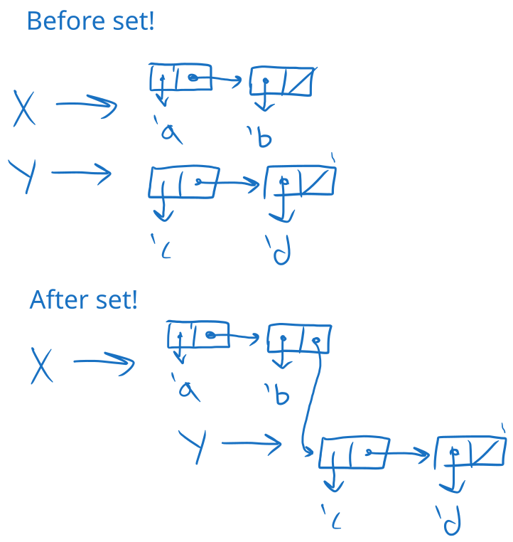
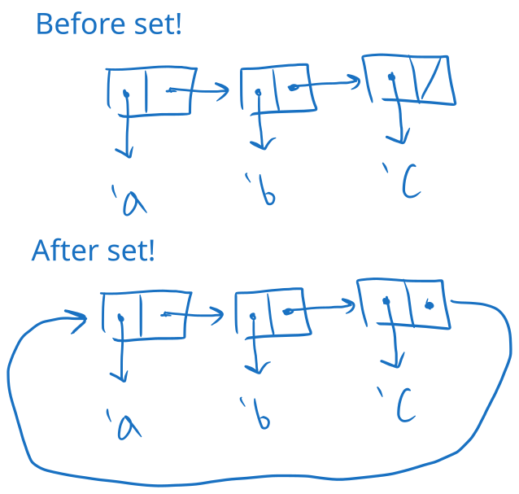
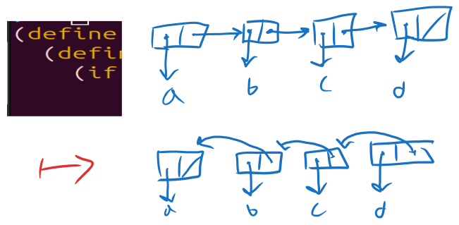
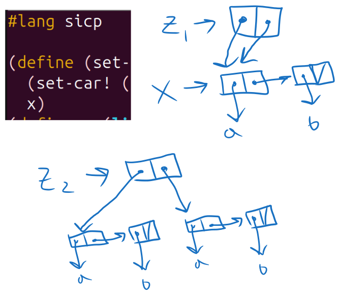
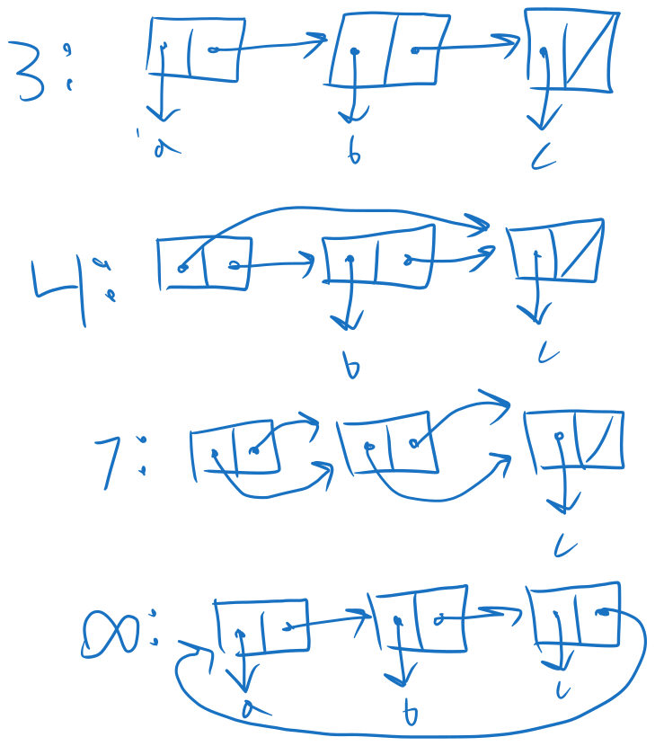
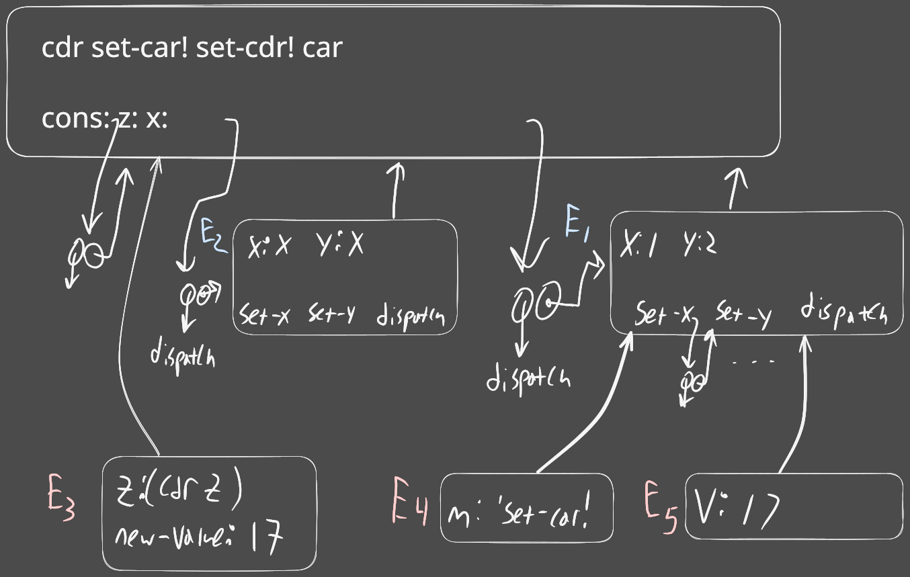
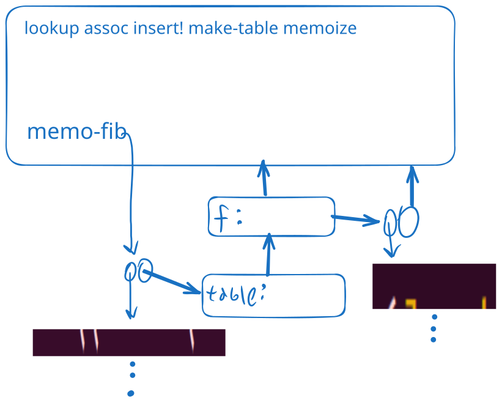
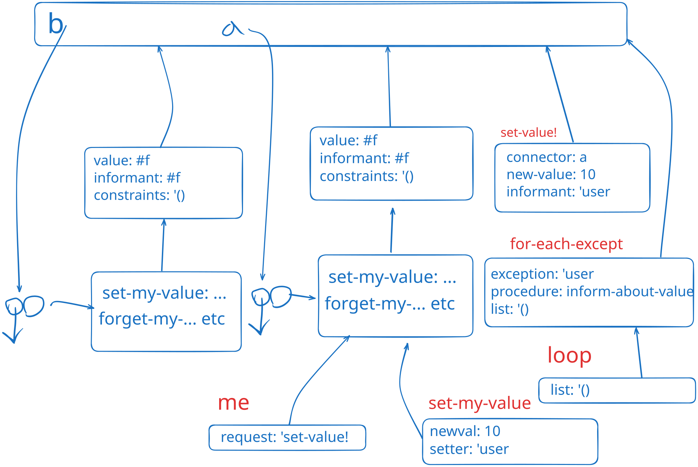

    <a href="notes-ch3-2.html">← Previous</a>
    <a href="../index.html">↑ Up</a>
    <a href="notes-ch3-4.html">Next →</a>

[HTML Book Chapter 3.3 Link](https://sarabander.github.io/sicp/html/3_002e3.xhtml#g_t3_002e3)

## Directory
- [Section 3.3](#section-33)
  - [Notes](#notes)
  - [Circuit example](#circuit-example)
    - [Inserting in the middle of a list](#inserting-in-the-middle-of-a-list)
  - [Constraint solving example](#constraint-solving-example)
  - [Meeting 05-25-2025](#meeting-05-25-2025)
  - [Exercises](#exercises)
    - *Exercises:* ([Exercise 3.12](#exercise-312), [Exercise 3.13](#exercise-313), [Exercise 3.14](#exercise-314), [Exercise 3.15](#exercise-315), [Exercise 3.16](#exercise-316), [Exercise 3.17](#exercise-317), [Exercise 3.18](#exercise-318), [Exercise 3.19](#exercise-319), [Exercise 3.20](#exercise-320), [Exercise 3.21](#exercise-321), [Exercise 3.22](#exercise-322), [Exercise 3.23](#exercise-323), [Exercise 3.24](#exercise-324), [Exercise 3.25](#exercise-325), [Exercise 3.26](#exercise-326), [Exercise 3.27](#exercise-327), [Exercise 3.28](#exercise-328), [Exercise 3.29](#exercise-329), [Exercise 3.30](#exercise-330), [Exercise 3.31](#exercise-331), [Exercise 3.32](#exercise-332), [Exercise 3.33](#exercise-333), [Exercise 3.34](#exercise-334), [Exercise 3.35](#exercise-335), [Exercise 3.36](#exercise-336), [Exercise 3.37](#exercise-337))

## Section 3.3

### Notes

<a href="code/examples-3-3.rkt">code/examples-3-3.rkt</a>

<pre>#lang sicp

(define x &#39;((a b) c d))
(define y &#39;(e f))

(set-car! x y)

(set-car! y &#39;h)
x
y
</pre>

Output:
<pre>((h f) c d)
(h f)
</pre>

 - It would be nice to have a proof that we can't construct an (efficient) queue
without `set!`, or if that's true.
 - Impossibility of an efficient doubly linked list without mutability? 
(there was a conversation about doubly linked lists in Rust)

### Circuit example

Running the example in section 3.3.4.

<a href="code/circuit.rkt">code/circuit.rkt</a> (click to expand)

<pre>#lang sicp

(define (front-ptr queue) (car queue))
(define (rear-ptr queue) (cdr queue))
(define (set-front-ptr! queue item) 
  (set-car! queue item))
(define (set-rear-ptr! queue item) 
  (set-cdr! queue item))
(define (empty-queue? queue) 
  (null? (front-ptr queue)))
(define (make-queue) (cons &#39;() &#39;()))

(define (front-queue queue)
  (if (empty-queue? queue)
      (error &quot;FRONT called with an
              empty queue&quot; queue)
      (car (front-ptr queue))))

(define (insert-queue! queue item)
  (let ((new-pair (cons item &#39;())))
    (cond ((empty-queue? queue)
           (set-front-ptr! queue new-pair)
           (set-rear-ptr! queue new-pair)
           queue)
          (else (set-cdr! (rear-ptr queue) 
                          new-pair)
                (set-rear-ptr! queue new-pair)
                queue))))
(define (delete-queue! queue)
  (cond ((empty-queue? queue)
         (error &quot;DELETE! called with 
                 an empty queue&quot; queue))
        (else (set-front-ptr! 
               queue 
               (cdr (front-ptr queue)))
              queue)))

(define (print-queue queue)
  (display (front-ptr queue)) (newline))
(define (half-adder a b s c)
  (let ((d (make-wire)) (e (make-wire)))
    (or-gate a b d)
    (and-gate a b c)
    (inverter c e)
    (and-gate d e s)
    &#39;ok))

(define (full-adder a b c-in sum c-out)
  (let ((c1 (make-wire))
        (c2 (make-wire))
        (s  (make-wire)))
    (half-adder b c-in s c1)
    (half-adder a s sum c2)
    (or-gate c1 c2 c-out)
    &#39;ok))

(define (inverter input output)
  (define (invert-input)
    (let ((new-value 
           (logical-not (get-signal input))))
      (after-delay 
       inverter-delay
       (lambda ()
         (set-signal! output new-value)))))
  (add-action! input invert-input)
  &#39;ok)

(define (binary? a)
  (or (= a 1) (= a 0)))
(define (logical-not s)
  (cond ((= s 0) 1)
        ((= s 1) 0)
        (else (error &quot;Invalid signal&quot; s))))
(define (logical-and a b)
  (cond ((and (= a 1) (= b 1)) 1)
        ((and (binary? a) (binary? b)) 0)
        (else (error &quot;Invalid signal&quot; a b))))
(define (logical-or a b)
  (cond ((or (= a 1) (= b 1)) 1)
        ((and (binary? a) (binary? b)) 0)
        (else (error &quot;Invalid signal&quot; a b))))

(define (and-gate a1 a2 output)
  (define (and-action-procedure)
    (let ((new-value
           (logical-and (get-signal a1)
                        (get-signal a2))))
      (after-delay
       and-gate-delay
       (lambda ()
         (set-signal! output new-value)))))
  (add-action! a1 and-action-procedure)
  (add-action! a2 and-action-procedure)
  &#39;ok)

(define (or-gate a1 a2 output)
  (define (or-action-procedure)
    (let ((new-value
           (logical-or (get-signal a1)
                       (get-signal a2))))
      (after-delay
       or-gate-delay
       (lambda ()
         (set-signal! output new-value)))))
  (add-action! a1 or-action-procedure)
  (add-action! a2 or-action-procedure)
  &#39;ok)

(define (or-gate2 a1 a2 output)
  (let ((a1inv (make-wire)) 
        (a2inv (make-wire)) 
        (outputinv (make-wire)))
    (inverter a1 a1inv)
    (inverter a2 a2inv)
    (and-gate a1inv a2inv outputinv)
    (inverter outputinv output)
    &#39;ok))

(define (ripple-carry A B S c)
  (define (ripple-carry-inner A B S c-out)
    (if (null? A) 
      &#39;ok
      (let ((c-in (make-wire)))
        (full-adder (car A) (car B) c-in (car S) c-out)
        (ripple-carry-inner (cdr A) (cdr B) (cdr S) c-in))))
  (ripple-carry A B S c))

(define (call-each procedures)
  (if (null? procedures)
      &#39;done
      (begin ((car procedures))
             (call-each (cdr procedures)))))

(define (make-wire)
  (let ((signal-value 0)
        (action-procedures &#39;()))
    (define (set-my-signal! new-value)
      (if (not (= signal-value new-value))
          (begin (set! signal-value new-value)
                 (call-each
                  action-procedures))
          &#39;done))
    (define (accept-action-procedure! proc)
      (set! action-procedures
            (cons proc action-procedures))
      (proc))
    (define (dispatch m)
      (cond ((eq? m &#39;get-signal)
             signal-value)
            ((eq? m &#39;set-signal!)
             set-my-signal!)
            ((eq? m &#39;add-action!)
             accept-action-procedure!)
            (else (error &quot;Unknown operation:
                          WIRE&quot; m))))
    dispatch))

(define (get-signal wire)
  (wire &#39;get-signal))
(define (set-signal! wire new-value)
  ((wire &#39;set-signal!) new-value))
(define (add-action! wire action-procedure)
  ((wire &#39;add-action!) action-procedure))

(define (make-time-segment time queue)
  (cons time queue))
(define (segment-time s) (car s))
(define (segment-queue s) (cdr s))

(define (make-agenda) (list 0))
(define (current-time agenda) (car agenda))
(define (set-current-time! agenda time)
  (set-car! agenda time))
(define (segments agenda) (cdr agenda))
(define (set-segments! agenda segments)
  (set-cdr! agenda segments))
(define (first-segment agenda)
  (car (segments agenda)))
(define (rest-segments agenda)
  (cdr (segments agenda)))
(define (empty-agenda? agenda)
  (null? (segments agenda)))
(define (add-to-agenda! time action agenda)
  (define (belongs-before? segments)
    (or (null? segments)
        (&lt; time
           (segment-time (car segments)))))
  (define (make-new-time-segment time action)
    (let ((q (make-queue)))
      (insert-queue! q action)
      (make-time-segment time q)))
  (define (add-to-segments! segments)
    (if (= (segment-time (car segments)) time)
        (insert-queue!
         (segment-queue (car segments))
         action)
        (let ((rest (cdr segments)))
          (if (belongs-before? rest)
              (set-cdr!
               segments
               (cons (make-new-time-segment
                      time
                      action)
                     (cdr segments)))
              (add-to-segments! rest)))))
  (let ((segments (segments agenda)))
    (if (belongs-before? segments)
        (set-segments!
         agenda
         (cons (make-new-time-segment
                time
                action)
               segments))
        (add-to-segments! segments))))

(define (remove-first-agenda-item! agenda)
  (let ((q (segment-queue
            (first-segment agenda))))
    (delete-queue! q)
    (if (empty-queue? q)
        (set-segments!
         agenda
         (rest-segments agenda)))))

(define (first-agenda-item agenda)
  (if (empty-agenda? agenda)
      (error &quot;Agenda is empty: 
              FIRST-AGENDA-ITEM&quot;)
      (let ((first-seg 
             (first-segment agenda)))
        (set-current-time! 
         agenda 
         (segment-time first-seg))
        (front-queue 
         (segment-queue first-seg)))))

(define (after-delay delay action)
  (add-to-agenda!
   (+ delay (current-time the-agenda))
   action
   the-agenda))
(define (propagate)
  (if (empty-agenda? the-agenda)
      &#39;done
      (let ((first-item 
             (first-agenda-item the-agenda)))
        (first-item)
        (remove-first-agenda-item! the-agenda)
        (propagate))))

(define (probe name wire)
  (add-action!
   wire
   (lambda ()
     (newline)
     (display name)
     (display &quot; &quot;)
     (display (current-time the-agenda))
     (display &quot;  New-value = &quot;)
     (display (get-signal wire)))))

(define the-agenda (make-agenda))
(define inverter-delay 2)
(define and-gate-delay 3)
(define or-gate-delay 5)

(define input-1 (make-wire))
(define input-2 (make-wire))
(define sum (make-wire))
(define carry (make-wire))

(probe &#39;sum sum)
; sum 0  New-value = 0

(probe &#39;carry carry)
; carry 0  New-value = 0

(half-adder input-1 input-2 sum carry)
; ok

(set-signal! input-1 1)
; done

(propagate)
; sum 8  New-value = 1
; done
(set-signal! input-2 1)
; done

(propagate)
; carry 11  New-value = 1
; sum 16  New-value = 0
; done
</pre>

Output:
<pre>
sum 0  New-value = 0
carry 0  New-value = 0ok
done

sum 8  New-value = 1done
done

carry 11  New-value = 1
sum 16  New-value = 0done
</pre>

#### Inserting in the middle of a list

I saw this pattern inside `add-to-agenda!` which was kind of 
interesting. Inserting into the middle of a list (except the first element) is easy with this function, which is basically how `add-to-segments!` works, except it uses a predicate instead of a index `n`.

<pre>;; insert element el at position n of the list.
;; except for position 0
(define (insert! lst n el)
  (if (= n 1)
    (set-cdr! lst 
        (cons el (cdr lst)))
    (insert! (cdr lst) (- n 1) el)))
</pre>

### Constraint solving example

Running the example in section 3.3.5.

<a href="code/constraint.rkt">code/constraint.rkt</a> (click to expand)

<pre>#lang sicp

(define (has-value? connector)
  (connector &#39;has-value?))
(define (get-value connector)
  (connector &#39;value))
(define (set-value! connector 
                    new-value 
                    informant)
  ((connector &#39;set-value!) 
   new-value 
   informant))
(define (forget-value! connector retractor)
  ((connector &#39;forget) retractor))
(define (connect connector new-constraint)
  ((connector &#39;connect) new-constraint))

(define (adder a1 a2 sum)
  (define (process-new-value)
    (cond ((and (has-value? a1) 
                (has-value? a2))
           (set-value! sum
                       (+ (get-value a1) 
                          (get-value a2))
                       me))
          ((and (has-value? a1) 
                (has-value? sum))
           (set-value! a2
                       (- (get-value sum) 
                          (get-value a1))
                       me))
          ((and (has-value? a2) 
                (has-value? sum))
           (set-value! a1
                       (- (get-value sum) 
                          (get-value a2))
                       me))))
  (define (process-forget-value)
    (forget-value! sum me)
    (forget-value! a1 me)
    (forget-value! a2 me)
    (process-new-value))
  (define (me request)
    (cond ((eq? request &#39;I-have-a-value)
           (process-new-value))
          ((eq? request &#39;I-lost-my-value)
           (process-forget-value))
          (else (error &quot;Unknown request: 
                        ADDER&quot; request))))
  (connect a1 me)
  (connect a2 me)
  (connect sum me)
  me)
(define (multiplier m1 m2 product)
  (define (process-new-value)
    (cond ((or (and (has-value? m1)
                    (= (get-value m1) 0))
               (and (has-value? m2)
                    (= (get-value m2) 0)))
           (set-value! product 0 me))
          ((and (has-value? m1)
                (has-value? m2))
           (set-value! product
                       (* (get-value m1)
                          (get-value m2))
                       me))
          ((and (has-value? product)
                (has-value? m1))
           (set-value! m2
                       (/ (get-value product)
                          (get-value m1))
                       me))
          ((and (has-value? product)
                (has-value? m2))
           (set-value! m1
                       (/ (get-value product)
                          (get-value m2))
                       me))))
  (define (process-forget-value)
    (forget-value! product me)
    (forget-value! m1 me)
    (forget-value! m2 me)
    (process-new-value))
  (define (me request)
    (cond ((eq? request &#39;I-have-a-value)
           (process-new-value))
          ((eq? request &#39;I-lost-my-value)
           (process-forget-value))
          (else
           (error &quot;Unknown request:
                   MULTIPLIER&quot;
                  request))))
  (connect m1 me)
  (connect m2 me)
  (connect product me)
  me)

(define (inform-about-value constraint)
  (constraint &#39;I-have-a-value))
(define (inform-about-no-value constraint)
  (constraint &#39;I-lost-my-value))

(define (constant value connector)
  (define (me request)
    (error &quot;Unknown request: CONSTANT&quot;
           request))
  (connect connector me)
  (set-value! connector value me)
  me)

(define (probe name connector)
  (define (print-probe value)
    (display &quot;Probe: &quot;)
    (display name) (display &quot; = &quot;)
    (display value) (newline) )
  (define (process-new-value)
    (print-probe (get-value connector)))
  (define (process-forget-value)
    (print-probe &quot;?&quot;))
  (define (me request)
    (cond ((eq? request &#39;I-have-a-value)
           (process-new-value))
          ((eq? request &#39;I-lost-my-value)
           (process-forget-value))
          (else (error &quot;Unknown request: 
                        PROBE&quot; request))))
  (connect connector me)
  me)

(define (make-connector)
  (let ((value false)
        (informant false)
        (constraints &#39;()))
    (define (set-my-value newval setter)
      (cond ((not (has-value? me))
             (set! value newval)
             (set! informant setter)
             (for-each-except
              setter
              inform-about-value
              constraints))
            ((not (= value newval))
             (error &quot;Contradiction&quot;
                    (list value newval)))
            (else &#39;ignored)))
    (define (forget-my-value retractor)
      (if (eq? retractor informant)
          (begin (set! informant false)
                 (for-each-except
                  retractor
                  inform-about-no-value
                  constraints))
          &#39;ignored))
    (define (connect new-constraint)
      (if (not (memq new-constraint
                     constraints))
          (set! constraints
                (cons new-constraint
                      constraints)))
      (if (has-value? me)
          (inform-about-value new-constraint))
      &#39;done)
    (define (me request)
      (cond ((eq? request &#39;has-value?)
             (if informant true false))
            ((eq? request &#39;value) value)
            ((eq? request &#39;set-value!)
             set-my-value)
            ((eq? request &#39;forget)
             forget-my-value)
            ((eq? request &#39;connect) connect)
            (else (error &quot;Unknown operation:
                          CONNECTOR&quot;
                         request))))
    me))

(define (for-each-except exception 
                         procedure 
                         list)
  (define (loop items)
    (cond ((null? items) &#39;done)
          ((eq? (car items) exception) 
           (loop (cdr items)))
          (else (procedure (car items))
                (loop (cdr items)))))
  (loop list))

(define C (make-connector))
(define F (make-connector))
(define (celsius-fahrenheit-converter c f)
  (let ((u (make-connector))
        (v (make-connector))
        (w (make-connector))
        (x (make-connector))
        (y (make-connector)))
    (multiplier c w u)
    (multiplier v x u)
    (adder v y f)
    (constant 9 w)
    (constant 5 x)
    (constant 32 y)
    &#39;ok))
(celsius-fahrenheit-converter C F)

(probe &quot;Celsius temp&quot; C)
(probe &quot;Fahrenheit temp&quot; F)
(set-value! C 25 &#39;user)
;; Probe: Celsius temp = 25
;; Probe: Fahrenheit temp = 77
;; done

; (set-value! F 212 &#39;user)
;; Error! Contradiction (77 212)

(forget-value! C &#39;user)
;; Probe: Celsius temp = ?
;; Probe: Fahrenheit temp = ?
;; done

(set-value! F 212 &#39;user)
;; Probe: Fahrenheit temp = 212
;; Probe: Celsius temp = 100
;; done
</pre>

Output:
<pre>ok
#&lt;procedure:...code/constraint.rkt:120:2&gt;
#&lt;procedure:...code/constraint.rkt:120:2&gt;
Probe: Celsius temp = 25
Probe: Fahrenheit temp = 77
done
Probe: Celsius temp = ?
Probe: Fahrenheit temp = ?
done
Probe: Fahrenheit temp = 212
Probe: Celsius temp = 100
done
</pre>

### Meeting 05-25-2025

- Eric Grimson 2004 MIT lectures on SICP [13. Environment Model](https://www.youtube.com/watch?v=SDsxFreEYsc&list=PL7BcsI5ueSNFPCEisbaoQ0kXIDX9rR5FF&t=1962s).
 - [From here to lambda and back again - Douglas Crockford at RacketCon](https://www.youtube.com/watch?v=vMDHpPN_p08)
 - p-list vs a-list
 - In the context of the end of chapter 3-3, constraint solvers: First order predicate and expert systems.

 - Note on one of the problems: Given the implementation of `append!`, I had to intialize a supposedly empty list to a dummy pair `(list dummy '())`. Specifically I was referring to the line `(define tracker (list 'first-element))` in my solution to [exercise 17](https://physbuzz.github.io/sicp/ch3/notes-ch3-3.html#exercise-317)
 - [Common lisp quick reference](http://clqr.boundp.org/)

### Exercises

#### Exercise 3.12

The following procedure for
appending lists was introduced in 2.2.1:

<pre>(define (append x y)
  (if (null? x)
      y
      (cons (car x) (append (cdr x) y))))
</pre>

`Append` forms a new list by successively `cons`ing the elements of
`x` onto `y`.  The procedure `append!` is similar to
`append`, but it is a mutator rather than a constructor.  It appends the
lists by splicing them together, modifying the final pair of `x` so that
its `cdr` is now `y`.  (It is an error to call `append!` with an
empty `x`.)

<pre>(define (append! x y)
  (set-cdr! (last-pair x) y)
  x)
</pre>

Here `last-pair` is a procedure that returns the last pair in its
argument:

<pre>(define (last-pair x)
  (if (null? (cdr x))
      x
      (last-pair (cdr x))))
</pre>

Consider the interaction

<pre>(define x (list &#39;a &#39;b))
(define y (list &#39;c &#39;d))
(define z (append x y))

z
(a b c d)

(cdr x)
⟨response⟩

(define w (append! x y))

w
(a b c d)

(cdr x)
⟨response⟩
</pre>

What are the missing `⟨response⟩`s?  Draw box-and-pointer diagrams to
explain your answer.

##### Solution

<a href="code/ex3-12.rkt">code/ex3-12.rkt</a>

<pre>#lang sicp

(define (append! x y)
  (set-cdr! (last-pair x) y)
  x)

(define (last-pair x)
  (if (null? (cdr x))
      x
      (last-pair (cdr x))))

(define x (list &#39;a &#39;b))
(define y (list &#39;c &#39;d))
(define z (append x y))

z
; (a b c d)

(cdr x)
; (b)

(define w (append! x y))
; (last-pair x) gives (cons &#39;b nil)
; We set this pair&#39;s 2nd element to y, which is (cons &#39;c (cons &#39;d nil))
; So x is now &#39;(a b c d)

w
; (a b c d)

(cdr x)
; (b c d)
</pre>

Output:
<pre>(a b c d)
(b)
(a b c d)
(b c d)
</pre>

  

#### Exercise 3.13

Consider the following
`make-cycle` procedure, which uses the `last-pair` procedure defined
in Exercise 3.12:

<pre>(define (make-cycle x)
  (set-cdr! (last-pair x) x)
  x)
</pre>

Draw a box-and-pointer diagram that shows the structure `z` created by

<pre>(define z (make-cycle (list &#39;a &#39;b &#39;c)))
</pre>

What happens if we try to compute `(last-pair z)`?

##### Solution

If we try to compute `(last-pair z)`, the algorithm will run
until it finds a pair which has a cdr equal to nil. Unfortunately this will never happen!

  

#### Exercise 3.14

The following procedure is quite
useful, although obscure:

<pre>(define (mystery x)
  (define (loop x y)
    (if (null? x)
        y
        (let ((temp (cdr x)))
          (set-cdr! x y)
          (loop temp x))))
  (loop x &#39;()))
</pre>

`Loop` uses the "temporary" variable `temp` to hold the old value
of the `cdr` of `x`, since the `set-cdr!`  on the next line
destroys the `cdr`.  Explain what `mystery` does in general.  Suppose
`v` is defined by `(define v (list 'a 'b 'c 'd))`. Draw the
box-and-pointer diagram that represents the list to which `v` is bound.
Suppose that we now evaluate `(define w (mystery v))`. Draw
box-and-pointer diagrams that show the structures `v` and `w` after
evaluating this expression.  What would be printed as the values of `v`
and `w`?

##### Solution

<a href="code/ex3-14.rkt">code/ex3-14.rkt</a>

<pre>#lang sicp

; invariants: 
;   x and y together contain all original elements of x
;   y contains elements of the original x in reversed order
;   
(define (mystery x)
  (define (loop x y)
    (if (null? x)
        y
        (let ((temp (cdr x)))
          (set-cdr! x y)
          (loop temp x))))
  (loop x &#39;()))

(define v (list &#39;a &#39;b &#39;c &#39;d))
(define w (mystery v))

w
v
</pre>

Output:
<pre>(d c b a)
(a)
</pre>

This is a recursive algorithm for reversing a linked list. One way to see this is
to look at the invariant `(append (reverse y) x)`, which will always be equal to
the original list. Certainly it's true for `y='()` and `x=list`. On subsequent steps,
we can look at the function call `(loop temp x-modified)` and work backwards 
(where I use `x-modified` to refer to x after being mutated with `set-cdr!`

<pre>(append (reverse x-modified) temp)
=(append (reverse (cons (car x) y)) (cdr x))
=(append (reverse y) (cons (car x) (cdr x)))
=(append (reverse y) x)
</pre>

So the loop invariant is preserved, the length of the first argument decreases by one
each step, and at the end when `x='()` we have `list = (reverse y)` so the list is reversed.

Less proof-ey, more intuitively, recall that every pair in the linked list has a pointer to the element stored
and a pointer to the next element stored. We want to change this second pointer 
to point towards the previous element in the list. We do this by storing 
the previous pair in the list as `y` and the rest of the not-updated list as `x`.

  

#### Exercise 3.15

Draw box-and-pointer diagrams to
explain the effect of `set-to-wow!` on the structures `z1` and
`z2` above.

##### Solution

  

So this explains why in the first case when we call `set-to-wow!` it seems like
"both pairs" are changed. In fact we are changing the first pair, x, and it is pointed to
twice.

In the case of `z2`, these point to two separate lists.

#### Exercise 3.16

Ben Bitdiddle decides to write a
procedure to count the number of pairs in any list structure.  ``It's easy,''
he reasons.  ``The number of pairs in any structure is the number in the
`car` plus the number in the `cdr` plus one more to count the current
pair.''  So Ben writes the following procedure:

<pre>(define (count-pairs x)
  (if (not (pair? x))
      0
      (+ (count-pairs (car x))
         (count-pairs (cdr x))
         1)))
</pre>

Show that this procedure is not correct.  In particular, draw box-and-pointer
diagrams representing list structures made up of exactly three pairs for which
Ben's procedure would return 3; return 4; return 7; never return at all.

##### Solution

<a href="code/ex3-16.rkt">code/ex3-16.rkt</a>

<pre>#lang sicp

(define (count-pairs x)
  (if (not (pair? x))
      0
      (+ (count-pairs (car x))
         (count-pairs (cdr x))
         1)))

(define list1 &#39;(a b c))
(count-pairs list1)

(define list2 &#39;(a b c))
(set-car! list2 (cdr list2))
(set-cdr! list2 (cddr list2))
(count-pairs list2)

(define list3 &#39;(a b c))
(set-car! (cdr list3) (cddr list3))
(set-car! list3 (cdr list3))
(count-pairs list3)

;; We could do the following, but it would never halt so I&#39;m not doing it
;; (define list4 &#39;(a c))
;; (set-cdr! (cdr list4) list4)
;; (count-pairs list4)
</pre>

Output:
<pre>3
4
7
</pre>

The explanation of the construction of the four different lists is explained
in this image:

  

#### Exercise 3.17

Devise a correct version of the
`count-pairs` procedure of Exercise 3.16 that returns the number of
distinct pairs in any structure.  (Hint: Traverse the structure, maintaining an
auxiliary data structure that is used to keep track of which pairs have already
been counted.)

##### Solution

<a href="code/ex3-17.rkt">code/ex3-17.rkt</a>

<pre>#lang sicp

(define (last-pair x)
  (if (null? (cdr x))
      x
      (last-pair (cdr x))))
(define (append! x y)
  (set-cdr! (last-pair x) y)
  x)

(define (member? x lst) 
  (cond ((null? lst) #f)
        ((eq? x (car lst)) #t)
        (else (member? x (cdr lst)))))

(define (count-pairs x)
  (define tracker (list &#39;first-element))
  (define (count-pairs-inner x tracker)
    (cond ((not (pair? x)) 0)
          ((member? x tracker) 0)
          (else (begin 
            (append! tracker (list x))
            (+ 1
               (count-pairs-inner (car x) tracker)
               (count-pairs-inner (cdr x) tracker))))))
  (count-pairs-inner x tracker))

(define list1 &#39;(a b c))
(count-pairs list1)

(define list2 &#39;(a b c))
(set-car! list2 (cdr list2))
(set-cdr! list2 (cddr list2))
(count-pairs list2)

(define list3 &#39;(a b c))
(set-car! (cdr list3) (cddr list3))
(set-car! list3 (cdr list3))
(count-pairs list3)

;; No more infinite looping!
(define list4 &#39;(a b c))
(set-cdr! (cddr list4) list4)
(count-pairs list4)
</pre>

Output:
<pre>3
3
3
3
</pre>

#### Exercise 3.18

Write a procedure that examines a
list and determines whether it contains a cycle, that is, whether a program
that tried to find the end of the list by taking successive `cdr`s would
go into an infinite loop.  Exercise 3.13 constructed such lists.

##### Solution

<a href="code/ex3-18.rkt">code/ex3-18.rkt</a>

<pre>#lang sicp

(define (last-pair x)
  (if (null? (cdr x))
      x
      (last-pair (cdr x))))
(define (append! x y)
  (set-cdr! (last-pair x) y)
  x)

(define (member? x lst) 
  (cond ((null? lst) #f)
        ((eq? x (car lst)) #t)
        (else (member? x (cdr lst)))))

(define (contains-loop? x)
  (define (loop-inner x tracker)
    (cond ((null? x) #f)
          ((member? x tracker) #t)
          (else (loop-inner (cdr x) (append tracker (list x))))))
  (loop-inner x &#39;()))

(define list1 &#39;(a b c))
(contains-loop? list1)

(define list2 &#39;(a b c))
(set-car! list2 (cdr list2))
(set-cdr! list2 (cddr list2))
(contains-loop? list2)

(define list3 &#39;(a b c))
(set-car! (cdr list3) (cddr list3))
(set-car! list3 (cdr list3))
(contains-loop? list3)

;; No more infinite looping!
(define list4 &#39;(a b c))
(set-cdr! (cddr list4) list4)
(contains-loop? list4)
</pre>

Output:
<pre>#f
#f
#f
#t
</pre>

#### Exercise 3.19

Redo Exercise 3.18 using an
algorithm that takes only a constant amount of space.  (This requires a very
clever idea.)

##### Solution

<a href="code/ex3-19.rkt">code/ex3-19.rkt</a>

<pre>#lang sicp

(define (last-pair x)
  (if (null? (cdr x))
      x
      (last-pair (cdr x))))
(define (append! x y)
  (set-cdr! (last-pair x) y)
  x)

(define (member? x lst) 
  (cond ((null? lst) #f)
        ((eq? x (car lst)) #t)
        (else (member? x (cdr lst)))))

(define (contains-loop? x)
  ;; Checks if we can cdr x n times
  (define (try-step x n)
    (cond ((= n 0) x)
          ((not (pair? x)) #f)
          (else (try-step (cdr x) (- n 1)))))
  (define (loop-inner x y)
    (let ((xnew (try-step x 1))
          (ynew (try-step y 2)))
      (cond ((or (not ynew) (not xnew)) #f)
            ((eq? xnew ynew) #t)
            (else (loop-inner xnew ynew)))))
  (loop-inner x x))

(define list1 &#39;(a b c))
(contains-loop? list1)

(define list2 &#39;(a b c))
(set-car! list2 (cdr list2))
(set-cdr! list2 (cddr list2))
(contains-loop? list2)

(define list3 &#39;(a b c))
(set-car! (cdr list3) (cddr list3))
(set-car! list3 (cdr list3))
(contains-loop? list3)

;; No more infinite looping!
(define list4 &#39;(a b c))
(set-cdr! (cddr list4) list4)
(contains-loop? list4)
</pre>

Output:
<pre>#f
#f
#f
#t
</pre>

The idea here is to use two "racers", racer x takes one step every turn, 
racer y takes two steps. If racer y ever passes racer x, there's a loop. 

#### Exercise 3.20

Draw environment diagrams to
illustrate the evaluation of the sequence of expressions

<pre>(define x (cons 1 2))
(define z (cons x x))

(set-car! (cdr z) 17)

(car x)
17
</pre>

using the procedural implementation of pairs given above.  (Compare
Exercise 3.11.)

##### Solution

  

Here's an incomplete answer to the question based on just some of the diagrams that I could have written.

The blue E1 and E2 are created by the calls to cons. 

The red environments are created by `set-car!`, `dispatch` and cons's version of 
`set-x!`. I ignore the small environments created by calling `(car z)`, which would involve another call to `dispatch`. 

#### Exercise 3.21

Ben Bitdiddle decides to test the
queue implementation described above.  He types in the procedures to the Lisp
interpreter and proceeds to try them out:

<pre>(define q1 (make-queue))

(insert-queue! q1 &#39;a)
((a) a)

(insert-queue! q1 &#39;b)
((a b) b)

(delete-queue! q1)
((b) b)

(delete-queue! q1)
(() b)
</pre>

"It's all wrong!" he complains.  "The interpreter's response shows that the
last item is inserted into the queue twice.  And when I delete both items, the
second `b` is still there, so the queue isn't empty, even though it's
supposed to be."  Eva Lu Ator suggests that Ben has misunderstood what is
happening. "It's not that the items are going into the queue twice," she
explains.  "It's just that the standard Lisp printer doesn't know how to make
sense of the queue representation. If you want to see the queue printed
correctly, you'll have to define your own print procedure for queues." Explain
what Eva Lu is talking about.  In particular, show why Ben's examples produce
the printed results that they do.  Define a procedure `print-queue` that
takes a queue as input and prints the sequence of items in the queue.

##### Solution

<a href="code/ex3-21.rkt">code/ex3-21.rkt</a>

<pre>#lang sicp

(define (front-ptr queue) (car queue))
(define (rear-ptr queue) (cdr queue))
(define (set-front-ptr! queue item) 
  (set-car! queue item))
(define (set-rear-ptr! queue item) 
  (set-cdr! queue item))
(define (empty-queue? queue) 
  (null? (front-ptr queue)))
(define (make-queue) (cons &#39;() &#39;()))

(define (front-queue queue)
  (if (empty-queue? queue)
      (error &quot;FRONT called with an
              empty queue&quot; queue)
      (car (front-ptr queue))))

(define (insert-queue! queue item)
  (let ((new-pair (cons item &#39;())))
    (cond ((empty-queue? queue)
           (set-front-ptr! queue new-pair)
           (set-rear-ptr! queue new-pair)
           queue)
          (else (set-cdr! (rear-ptr queue) 
                          new-pair)
                (set-rear-ptr! queue new-pair)
                queue))))
(define (delete-queue! queue)
  (cond ((empty-queue? queue)
         (error &quot;DELETE! called with 
                 an empty queue&quot; queue))
        (else (set-front-ptr! 
               queue 
               (cdr (front-ptr queue)))
              queue)))

(define (print-queue queue)
  (display (front-ptr queue)) (newline))

(define q1 (make-queue))

(insert-queue! q1 &#39;a)
;; ((a) a)
(print-queue q1)(newline)
;; (a)

(insert-queue! q1 &#39;b)
;; ((a b) b)
(print-queue q1)(newline)
;; (a )

(delete-queue! q1)
;; ((b) b)
(print-queue q1)(newline)
;; (b)

(delete-queue! q1)
;; (() b)
(print-queue q1)(newline)
;; ()
</pre>

Output:
<pre>((a) a)
(a)

((a b) b)
(a b)

((b) b)
(b)

(() b)
()

</pre>

#### Exercise 3.22

Instead of representing a queue
as a pair of pointers, we can build a queue as a procedure with local state.
The local state will consist of pointers to the beginning and the end of an
ordinary list.  Thus, the `make-queue` procedure will have the form

<pre>(define (make-queue)
  (let ((front-ptr … )
        (rear-ptr … ))
    ⟨@var{definitions of internal procedures}⟩
    (define (dispatch m) …)
    dispatch))
</pre>

Complete the definition of `make-queue` and provide implementations of the
queue operations using this representation.

##### Solution

<a href="code/ex3-22.rkt">code/ex3-22.rkt</a>

<pre>#lang sicp

(define (make-queue)
  (let ((front-ptr &#39;())
        (rear-ptr &#39;()))

    (define (set-front-ptr! item) 
      (set! front-ptr item))
    (define (set-rear-ptr! item) 
      (set! rear-ptr item))
    (define (empty-queue?) 
      (null? front-ptr))
    (define (front-queue)
      (if (empty-queue?)
        (error &quot;FRONT called with an
               empty queue&quot;)
        (car front-ptr)))
    (define (insert-queue! item)
      (let ((new-pair (cons item &#39;())))
        (cond ((empty-queue?)
               (set-front-ptr! new-pair)
               (set-rear-ptr! new-pair)
               dispatch) ;; Instead of queue, we return dispatch
                         ;; I&#39;m using this analogous to C++ &quot;this&quot; 
          (else (set-cdr! rear-ptr 
                          new-pair)
                (set-rear-ptr! new-pair)
                dispatch))))
    (define (delete-queue!)
      (cond ((empty-queue?)
             (error &quot;DELETE! called with 
                    an empty queue&quot;))
        (else (set-front-ptr! 
                            (cdr front-ptr))))
      dispatch)
    (define (print-queue)
      (display front-ptr) (newline))
    (define (dispatch m)
      (cond ((eq? m &#39;set-front-ptr!) set-front-ptr!)
            ((eq? m &#39;set-rear-ptr!) set-rear-ptr!)
            ((eq? m &#39;empty-queue?) empty-queue?)
            ((eq? m &#39;front-queue) front-queue)
            ((eq? m &#39;insert-queue!) insert-queue!)
            ((eq? m &#39;delete-queue!) delete-queue!)
            ((eq? m &#39;print-queue) print-queue)
            (else (error &quot;DELETE! called with 
                    an empty queue&quot;))))
    dispatch))

(define (set-front-ptr! q item) 
  ((q &#39;set-front-ptr!) item))
(define (set-rear-ptr! q item)
  ((q &#39;set-rear-ptr!) item))
(define (empty-queue? q)
  ((q &#39;empty-queue?)))
(define (front-queue q)
  ((q &#39;front-queue)))
(define (insert-queue! q item)
  ((q &#39;insert-queue!) item))
(define (delete-queue! q)
  ((q &#39;delete-queue!)))
(define (print-queue q)
  ((q &#39;print-queue)))

(define q1 (make-queue))
(print-queue (insert-queue! q1 &#39;a))
(print-queue (insert-queue! q1 &#39;b))
(print-queue (delete-queue! q1))
(print-queue (delete-queue! q1))
</pre>

Output:
<pre>(a)
(a b)
(b)
()
</pre>

#### Exercise 3.23

A deque (`double-ended queue`) is a sequence in which items can be inserted and deleted at either the
front or the rear.  Operations on deques are the constructor `make-deque`,
the predicate `empty-deque?`, selectors `front-deque` and
`rear-deque`, and mutators `front-insert-deque!`,
`rear-insert-deque!`, `front-delete-deque!`, 
`rear-delete-deque!`.  Show how to represent deques using pairs, and give
implementations of the operations.  
All operations should be accomplished in $\Theta(1)$ steps.

##### Solution

We have to roll our own doubly linked list, I'll have the list of the form:

<pre>&#39;((el1 &#39;()) (el2 prevptr2) ... (elN prevptrN))
</pre>

We have to make sure that when we add an element on the end, prev-ptr
is updated appropriately, and when we delete an element from the beginning
the appropriate prev-ptr is set to `nil`.

<a href="code/ex3-23.rkt">code/ex3-23.rkt</a>

<pre>#lang sicp

(define (front-ptr deque) (car deque))
(define (rear-ptr deque) (cdr deque))
(define (set-front-ptr! deque item) (set-car! deque item))
(define (set-rear-ptr! deque item) (set-cdr! deque item))
(define (empty-deque? deque) (null? (front-ptr deque)))
(define (make-deque) (cons &#39;() &#39;()))

;; Gets the first value in the deque
(define (front-deque deque)
  (if (empty-deque? deque)
      (error &quot;FRONT called with an
              empty deque&quot; deque)
      (car (front-ptr deque))))

;; Gets the last value in the deque
(define (rear-deque deque)
  (if (empty-deque? deque)
      (error &quot;REAR called with an
              empty deque&quot; deque)
      (car (rear-ptr deque))))

(define (rear-insert-deque! deque item)
  ;;cf ((new-pair (cons item &#39;())))
  (let ((new-pair (cons (list item &#39;()) &#39;())))
    (cond ((empty-deque? deque)
           (set-front-ptr! deque new-pair)
           (set-rear-ptr! deque new-pair)
           deque)
          (else 
              ;; 1. Update the new-pair&#39;s prev-ptr
              (set-car! (cdar new-pair) (rear-ptr deque))
              ;; 2. Add it to the end of the list
              (set-cdr! (rear-ptr deque) new-pair)
              ;; 3. Update rear-ptr.
              (set-rear-ptr! deque new-pair)
              deque))))

(define (rear-delete-deque! deque)
  (cond ((empty-deque? deque)
         (error &quot;REAR-DELETE! called with 
                 an empty deque&quot; deque))
        (else 
          ;; 1. Save the value of the prev-ptr
          (let ((prev-ptr (cadr (rear-deque deque))))
            ;; 2. If the prev ptr is null, set the queue to null
            (if (null? prev-ptr) 
              (begin 
                (set-front-ptr! deque &#39;())
                (set-rear-ptr! deque &#39;()))
              ;; 3. Else, chop the list off and move
              ;; rear-ptr back one.
              (begin
                (set-cdr! prev-ptr &#39;())
                (set-rear-ptr! deque prev-ptr)))
            deque))))

(define (front-insert-deque! deque item)
  (let ((new-pair (cons (list item &#39;()) (front-ptr deque))))
    (cond ((empty-deque? deque)
           (set-front-ptr! deque new-pair)
           (set-rear-ptr! deque new-pair)
           deque)
          (else (set-front-ptr! deque new-pair)
                deque))))

(define (front-delete-deque! deque)
  (cond ((empty-deque? deque)
         (error &quot;DELETE! called with 
                 an empty deque&quot; deque))
        (else (set-front-ptr! deque (cdr (front-ptr deque)))
              (if (not (null? (front-ptr deque)))
                ;; Update the first element&#39;s prev-ptr to null
                (set-car! (cdar (front-ptr deque)) &#39;()))
              deque)))

(define (print-deque deque)
  (define (print-deque-inner lst)
    (cond ((null? lst) (display &quot;)&quot;))
          ((null? (cdr lst))
            (display (caar lst)) (display &quot;)&quot;))
          (else (display (caar lst)) 
             (display &quot; &quot;)
             (print-deque-inner (cdr lst)))))
  (display &quot;(&quot;)
  (print-deque-inner (front-ptr deque)) (newline))

(define q1 (make-deque))

(print-deque (rear-insert-deque! q1 &#39;c))
(print-deque (rear-insert-deque! q1 &#39;d))
(print-deque (rear-insert-deque! q1 &#39;e))
(print-deque (front-delete-deque! q1))
(print-deque (front-insert-deque! q1 &#39;b))
(print-deque (front-insert-deque! q1 &#39;a))
(print-deque (rear-delete-deque! q1))
(print-deque (rear-insert-deque! q1 &#39;f))
(print-deque (rear-delete-deque! q1))
(print-deque (front-delete-deque! q1))
(print-deque (front-delete-deque! q1))
(print-deque (rear-delete-deque! q1))
</pre>

Output:
<pre>(c)
(c d)
(c d e)
(d e)
(b d e)
(a b d e)
(a b d)
(a b d f)
(a b d)
(b d)
(d)
()
</pre>

#### Exercise 3.24

In the table implementations
above, the keys are tested for equality using `equal?` (called by
`assoc`).  This is not always the appropriate test.  For instance, we
might have a table with numeric keys in which we don't need an exact match to
the number we're looking up, but only a number within some tolerance of it.
Design a table constructor `make-table` that takes as an argument a
`same-key?` procedure that will be used to test "equality" of keys.
`Make-table` should return a `dispatch` procedure that can be used to
access appropriate `lookup` and `insert!` procedures for a local
table.

##### Solution

<a href="code/ex3-24.rkt">code/ex3-24.rkt</a>

<pre>#lang sicp

(define (lookup key table)
  (let ((record (assoc key (cdr table))))
    (if record
        (cdr record)
        false)))

(define (assoc key records)
  (cond ((null? records) false)
        ((equal? key (caar records))
         (car records))
        (else (assoc key (cdr records)))))

(define (assoc-custom same-key? key records)
  (cond ((null? records) false)
        ((same-key? key (caar records))
         (car records))
        (else (assoc-custom same-key? key (cdr records)))))

(define (make-table same-key?)
  (let ((local-table (list &#39;*table*)))
    (define (lookup key-1 key-2)
      (let ((subtable
             (assoc-custom same-key? key-1 (cdr local-table))))
        (if subtable
            (let ((record
                   (assoc-custom same-key? key-2
                          (cdr subtable))))
              (if record (cdr record) false))
            false)))
    (define (insert! key-1 key-2 value)
      (let ((subtable
             (assoc-custom same-key? key-1 (cdr local-table))))
        (if subtable
            (let ((record
                   (assoc-custom same-key? key-2
                          (cdr subtable))))
              (if record
                  (set-cdr! record value)
                  (set-cdr!
                   subtable
                   (cons (cons key-2 value)
                         (cdr subtable)))))
            (set-cdr!
             local-table
             (cons (list key-1
                         (cons key-2 value))
                   (cdr local-table)))))
      &#39;ok)
    (define (dispatch m)
      (cond ((eq? m &#39;lookup-proc) lookup)
            ((eq? m &#39;insert-proc!) insert!)
            (else (error &quot;Unknown operation:
                          TABLE&quot; m))))
    dispatch))

(define (fuzzy-equals? a b)
  (&lt; (abs (- b a)) 0.05))

(define operation-table (make-table fuzzy-equals?))
(define get (operation-table &#39;lookup-proc))
(define put (operation-table &#39;insert-proc!))

(put 1 0.1 &#39;a)
(put 1 0.3 &#39;b)
(display (get 1 0.13)) (newline)
(display (get 1 0.2)) (newline)
(display (get 1 0.26))
</pre>

Output:
<pre>ok
ok
a
#f
b</pre>

#### Exercise 3.25

Generalizing one- and
two-dimensional tables, show how to implement a table in which values are
stored under an arbitrary number of keys and different values may be stored
under different numbers of keys.  The `lookup` and `insert!`
procedures should take as input a list of keys used to access the table.

##### Solution

I took the easy way out, and just used lists as keys instead of nested tables.
This could have some performance implications if we don't apply the 
binary search from exercise 3-26.

<a href="code/ex3-25.rkt">code/ex3-25.rkt</a>

<pre>#lang sicp

(define (assoc key records)
  (cond ((null? records) false)
        ((equal? key (caar records))
         (car records))
        (else (assoc key (cdr records)))))

(define (make-table)
  (let ((local-table (list &#39;*table*)))
    (define (lookup . keys)
      (let ((record
             (assoc keys (cdr local-table))))
        (if record (cdr record) false)))
    (define (insert! value . keys)
      (let ((record
             (assoc keys (cdr local-table))))
        (if record
            (set-cdr! record value)
            (set-cdr!
             local-table
             (cons (cons keys value)
                   (cdr local-table)))))
      &#39;ok)
    (define (dispatch m)
      (cond ((eq? m &#39;lookup-proc) lookup)
            ((eq? m &#39;insert-proc!) insert!)
            (else (error &quot;Unknown operation:
                          TABLE&quot; m))))
    dispatch))

(define operation-table (make-table))
(define get (operation-table &#39;lookup-proc))
(define put (operation-table &#39;insert-proc!))

(put 1 &#39;a &#39;b)
(put 2 &#39;c &#39;b)
(put 3 &#39;c &#39;b &#39;d &#39;e)
(display (get &#39;a &#39;b)) (newline)
(display (get &#39;c &#39;b)) (newline)
(display (get &#39;c &#39;b &#39;d &#39;e)) (newline)
</pre>

Output:
<pre>ok
ok
ok
1
2
3
</pre>

#### Exercise 3.26

To search a table as implemented
above, one needs to scan through the list of records.  This is basically the
unordered list representation of 2.3.3.  For large tables, it may
be more efficient to structure the table in a different manner.  Describe a
table implementation where the (key, value) records are organized using a
binary tree, assuming that keys can be ordered in some way (e.g., numerically
or alphabetically).  (Compare Exercise 2.66 of Chapter 2.)

##### Solution

This is a straightforward application of the binary trees we developed in chapter 2. There, the lookup pseudocode for [problem 2.66](../ch2/notes-ch2-3.html#exercise-266) was...

<pre>(define (lookup given-key records)
  (cond ((null? records) false)
        ((= given-key (key (entry records))) (entry record))
        ((&lt; given-key (key (entry records)))
         (lookup given-key (left-branch records)))
        ((&gt; given-key (key (entry records)))
         (lookup given-key (key (right-branch records))))))
</pre>

To get this to actually work we need an ordering on keys.
In Racket this can be done using `string<?` and `symbol->string`, 
I'm not sure if there's a better way. However, for example,
we used this to define a lexicographic ordering on 
monomials in [problem 2.92](../ch2/notes-ch2-5.html#exercise-292)

#### Exercise 3.27

Memoization (also
called tabulation) is a technique that enables a procedure to record,
in a local table, values that have previously been computed.  This technique
can make a vast difference in the performance of a program.  A memoized
procedure maintains a table in which values of previous calls are stored using
as keys the arguments that produced the values.  When the memoized procedure is
asked to compute a value, it first checks the table to see if the value is
already there and, if so, just returns that value.  Otherwise, it computes the
new value in the ordinary way and stores this in the table.  As an example of
memoization, recall from 1.2.2 the exponential process for
computing Fibonacci numbers:

<pre>(define (fib n)
  (cond ((= n 0) 0)
        ((= n 1) 1)
        (else (+ (fib (- n 1))
                 (fib (- n 2))))))
</pre>

The memoized version of the same procedure is

<pre>(define memo-fib
  (memoize 
   (lambda (n)
     (cond ((= n 0) 0)
           ((= n 1) 1)
           (else 
            (+ (memo-fib (- n 1))
               (memo-fib (- n 2))))))))
</pre>

where the memoizer is defined as

<pre>(define (memoize f)
  (let ((table (make-table)))
    (lambda (x)
      (let ((previously-computed-result 
             (lookup x table)))
        (or previously-computed-result
            (let ((result (f x)))
              (insert! x result table)
              result))))))
</pre>

Draw an environment diagram to analyze the computation of `(memo-fib 3)`.
Explain why `memo-fib` computes the $n^{\text{th}}$ Fibonacci number in a number
of steps proportional to $n$.  Would the scheme still work if we had simply
defined `memo-fib` to be `(memoize fib)`?

##### Solution

<a href="code/ex3-27.rkt">code/ex3-27.rkt</a>

<pre>#lang sicp

(define (lookup key table)
  (let ((record (assoc key (cdr table))))
    (if record
        (cdr record)
        false)))

(define (assoc key records)
  (cond ((null? records) false)
        ((equal? key (caar records)) 
         (car records))
        (else (assoc key (cdr records)))))

(define (insert! key value table)
  (let ((record (assoc key (cdr table))))
    (if record
        (set-cdr! record value)
        (set-cdr! table
                  (cons (cons key value)
                        (cdr table)))))
  &#39;ok)

(define (make-table)
  (list &#39;*table*))

(define (memoize f)
  (let ((table (make-table)))
    (lambda (x)
      (let ((previously-computed-result
             (lookup x table)))
        (or previously-computed-result
            (let ((result (f x)))
              (insert! x result table)
              result))))))

(define memo-fib
  (memoize 
   (lambda (n)
     (cond ((= n 0) 0)
           ((= n 1) 1)
           (else 
            (+ (memo-fib (- n 1))
               (memo-fib (- n 2))))))))

(memo-fib 10)
</pre>

Output:
<pre>55
</pre>

  

`memo-fib` computes each value at most once, and after this value is cached
it will simply be looked up the next time. 

I don't go into detail about all of the little environments created after
evaluating fib n, but you can find a good diagram here:

[https://github.com/kana/sicp/blob/master/ex-3.27.md](https://github.com/kana/sicp/blob/master/ex-3.27.md)

#### Exercise 3.28

Define an or-gate as a primitive
function box.  Your `or-gate` constructor should be similar to
`and-gate`.

##### Solution

<pre>(define (binary? a)
  (or (= a 1) (= a 0)))

(define (logical-or a b)
  (cond ((or (= a 1) (= b 1)) 1)
        ((and (binary? a) (binary? b)) 0)
        (else (error &quot;Invalid signal&quot; s))))

(define (or-gate a1 a2 output)
  (define (or-action-procedure)
    (let ((new-value
           (logical-or (get-signal a1)
                       (get-signal a2))))
      (after-delay
       or-gate-delay
       (lambda ()
         (set-signal! output new-value)))))
  (add-action! a1 or-action-procedure)
  (add-action! a2 or-action-procedure)
  &#39;ok)
</pre>

#### Exercise 3.29

Another way to construct an
or-gate is as a compound digital logic device, built from and-gates and
inverters.  Define a procedure `or-gate` that accomplishes this.  What is
the delay time of the or-gate in terms of `and-gate-delay` and
`inverter-delay`?

##### Solution

We use De Morgan's law that `(or a b)` is equivalent to 
`(not (and (not a) (not b)))`.

<pre>(define (or-gate2 a1 a2 output)
  (let ((a1inv (make-wire)) 
        (a2inv (make-wire)) 
        (outputinv (make-wire)))
    (inverter a1 a1inv)
    (inverter a2 a2inv)
    (and-gate a1inv a2inv outputinv)
    (inverter outputinv output)
    &#39;ok))
</pre>

The total delay is 

$$2\times\textrm{inverter-delay} + \textrm{and-gate-delay}$$

#### Exercise 3.30

Figure 3.27 shows a
ripple-carry adder formed by stringing together $n$ full-adders.
This is the simplest form of parallel adder for adding two $n$-bit binary
numbers.  The inputs $A_1, A_2, A_3, \ldots, A_n$ and 
$B_1, B_2, B_3, \ldots, B_n$
are the two binary numbers to be added (each $A_k$ and
$B_k$ is `a 0` or `a 1`). The circuit generates $S_1, S_2, 
S_3, \ldots, S_n$,
the $n$ bits of the sum, and $C$, the carry from the addition.  Write a
procedure `ripple-carry-adder` that generates this circuit.  The procedure
should take as arguments three lists of $n$ wires each---the $A_k$, the
$B_k$, and the $S_k$---and also another wire $C$.  The major drawback of the
ripple-carry adder is the need to wait for the carry signals to propagate.
What is the delay needed to obtain the complete output from an $n$-bit
ripple-carry adder, expressed in terms of the delays for and-gates, or-gates,
and inverters?

##### Solution

My solution is:

<pre>(define (ripple-carry A B S c)
  (define (ripple-carry-inner A B S c-out)
    (if (null? A) 
      &#39;ok
      (let ((c-in (make-wire)))
        (full-adder (car A) (car B) c-in (car S) c-out)
        (ripple-carry-inner (cdr A) (cdr B) (cdr S) c-in))))
  (ripple-carry A B S c))
</pre>

As for delays, in the half-adder `S` has the correct value after delay

$$
\texttt{half-s}=\max(\texttt{and-delay}+\texttt{or-delay},2\cdot\texttt{and-delay}+\texttt{inv-delay}).
$$

`C` has the correct value after delay equal to `and-delay`,

$$
\texttt{half-c}=\texttt{and-delay}.
$$

For a full-adder, `SUM` has the correct value after $2\texttt{half-s}$. 
`Cout` has the correct value after 

$$\begin{align*}\texttt{full-c}&=\texttt{or-delay}+\max(\texttt{half-s}+\texttt{and-delay},\texttt{and-delay})\\
&=\texttt{half-s}+\texttt{or-delay}+\texttt{and-delay}.
\end{align*}$$

So the first carry bit will be updated after time `full-c`. In general we need $n\texttt{C-delay}$ to get the correct output on the $C$ bit, and to get the correct output on $S_1$ we'll need $(n-1)\texttt{full-c}+\texttt{half-s}.$ 
So the total time needed is the max of these two quantities.

$$\begin{align*}\texttt{ripple-delay}&=
(n-1)\texttt{full-c}+\max(\texttt{full-c},2\cdot\texttt{half-s}) \\
&=(n-1)(\texttt{and-delay}+\texttt{or-delay}) \\
&\quad +(n+1)\max(2\cdot\texttt{and-delay}+\texttt{inv-delay},\\
&\qquad \texttt{and-delay}+\texttt{or-delay})
\end{align*}$$

We can also check this with Mathematica:

<pre>In[]:= halfS =  Max[a + o, 2 a + i];
halfC = a;
fullC = halfS +  o + a;
FullSimplify[(n - 1) fullC + Max[fullC, 2 halfS], Assumptions -&gt; {a &gt; 0, o &gt; 0, i &gt; 0, n &gt; 0}]

Out[]= (-1 + n) (a + o) + (1 + n) Max[2 a + i, a + o]
</pre>

To check against other answers found online, I found [this solution](https://github.com/kana/sicp/blob/master/ex-3.30.scm):

<pre>; Drs1 = max((3n+1)Da + (n+1)Di + (n-1)Do, 2n(Do + Da))
; Drs0 = max(3nDa + n(Di + Do), 2n(Do + Da))
</pre>

I took the max of these two quantities (I think there might be a typo, referring to `Drc0` and `Drs0`). If $2a+i\lt a+o$ we get the 
second argument of `Drs0` and so the answer agrees. If $2a+i\gt a+o,$
then we get the first argument of `Drs1`, so the answer agrees.

#### Exercise 3.31

The internal procedure
`accept-action-procedure!` defined in `make-wire` specifies that when
a new action procedure is added to a wire, the procedure is immediately run.
Explain why this initialization is necessary.  In particular, trace through the
half-adder example in the paragraphs above and say how the system's response
would differ if we had defined `accept-action-procedure!` as

<pre>(define (accept-action-procedure! proc)
  (set! action-procedures 
        (cons proc action-procedures)))
</pre>

##### Solution

Initially all wires have value zero. This is a problem because in the half-adder
there's a not gate, which should have default value 1. Running commands as they're passed in ensures that any circuit elements downstream of our element will be 
updated / intialized correctly. 

In the half-adder, if we didn't call this, we'd find the following weird behavior:

<pre>(set-signal! input-1 1)
(propagate)
(display (get-signal sum)) (newline)
; 0 -- incorrect!

(set-signal! input-2 1)
(propagate)
(display (get-signal sum)) (newline)
; 0 -- correct
</pre>

#### Exercise 3.32

The procedures to be run during
each time segment of the agenda are kept in a queue.  Thus, the procedures for
each segment are called in the order in which they were added to the agenda
(first in, first out).  Explain why this order must be used.  In particular,
trace the behavior of an and-gate whose inputs change from 0, 1 to 1, 0 in the
same segment and say how the behavior would differ if we stored a segment's
procedures in an ordinary list, adding and removing procedures only at the
front (last in, first out).

##### Solution

We're going to imagine that `a` and `b` are the wire inputs to the `and` gate,
that they have initial values 0 and 1 respectively, and that
we call the following commands:

<pre>(set-signal! a 1)
(set-signal! b 0)
(propagate)
</pre>

Each call to `set-signal!` runs the wires action procedures. The and gate's action
procedure runs this function:

<pre>  (define (and-action-procedure)
    (let ((new-value
           (logical-and (get-signal a1)
                        (get-signal a2))))
      (after-delay
       and-gate-delay
       (lambda ()
         (set-signal! output new-value)))))
</pre>

So we see we set the signal to the output value calculated **when the function is called.** This is different behavior than if our lambda was defined to calculate the logical and at the time that the output is updated. 
The issue with the current setup is that `(set-signal! a 1)` would add a
lambda `(set-signal! output 1)` to be ran later. 
Then `(set-signal! b 0)` would add a
lambda `(set-signal! output 0)` to be ran later. 

If we run these commands in the order last-in, first-out, the output ends up being 1!

#### Exercise 3.33

Using primitive multiplier,
adder, and constant constraints, define a procedure `averager` that takes
three connectors `a`, `b`, and `c` as inputs and establishes the
constraint that the value of `c` is the average of the values of `a`
and `b`.

##### Solution

<pre>(define (averager a b c)
  (let ((u (make-connector))
        (v (make-connector)))
    (adder a b u)
    (constant 2 v)
    (multiplier c v u)
    &#39;ok))
</pre>

<a href="code/ex3-33.rkt">code/ex3-33.rkt</a> (click to expand)

<pre>#lang sicp

(define (has-value? connector)
  (connector &#39;has-value?))
(define (get-value connector)
  (connector &#39;value))
(define (set-value! connector 
                    new-value 
                    informant)
  ((connector &#39;set-value!) 
   new-value 
   informant))
(define (forget-value! connector retractor)
  ((connector &#39;forget) retractor))
(define (connect connector new-constraint)
  ((connector &#39;connect) new-constraint))

(define (adder a1 a2 sum)
  (define (process-new-value)
    (cond ((and (has-value? a1) 
                (has-value? a2))
           (set-value! sum
                       (+ (get-value a1) 
                          (get-value a2))
                       me))
          ((and (has-value? a1) 
                (has-value? sum))
           (set-value! a2
                       (- (get-value sum) 
                          (get-value a1))
                       me))
          ((and (has-value? a2) 
                (has-value? sum))
           (set-value! a1
                       (- (get-value sum) 
                          (get-value a2))
                       me))))
  (define (process-forget-value)
    (forget-value! sum me)
    (forget-value! a1 me)
    (forget-value! a2 me)
    (process-new-value))
  (define (me request)
    (cond ((eq? request &#39;I-have-a-value)
           (process-new-value))
          ((eq? request &#39;I-lost-my-value)
           (process-forget-value))
          (else (error &quot;Unknown request: 
                        ADDER&quot; request))))
  (connect a1 me)
  (connect a2 me)
  (connect sum me)
  me)
(define (multiplier m1 m2 product)
  (define (process-new-value)
    (cond ((or (and (has-value? m1)
                    (= (get-value m1) 0))
               (and (has-value? m2)
                    (= (get-value m2) 0)))
           (set-value! product 0 me))
          ((and (has-value? m1)
                (has-value? m2))
           (set-value! product
                       (* (get-value m1)
                          (get-value m2))
                       me))
          ((and (has-value? product)
                (has-value? m1))
           (set-value! m2
                       (/ (get-value product)
                          (get-value m1))
                       me))
          ((and (has-value? product)
                (has-value? m2))
           (set-value! m1
                       (/ (get-value product)
                          (get-value m2))
                       me))))
  (define (process-forget-value)
    (forget-value! product me)
    (forget-value! m1 me)
    (forget-value! m2 me)
    (process-new-value))
  (define (me request)
    (cond ((eq? request &#39;I-have-a-value)
           (process-new-value))
          ((eq? request &#39;I-lost-my-value)
           (process-forget-value))
          (else
           (error &quot;Unknown request:
                   MULTIPLIER&quot;
                  request))))
  (connect m1 me)
  (connect m2 me)
  (connect product me)
  me)

(define (inform-about-value constraint)
  (constraint &#39;I-have-a-value))
(define (inform-about-no-value constraint)
  (constraint &#39;I-lost-my-value))

(define (constant value connector)
  (define (me request)
    (error &quot;Unknown request: CONSTANT&quot;
           request))
  (connect connector me)
  (set-value! connector value me)
  me)

(define (probe name connector)
  (define (print-probe value)
    (display &quot;Probe: &quot;)
    (display name) (display &quot; = &quot;)
    (display value) (newline) )
  (define (process-new-value)
    (print-probe (get-value connector)))
  (define (process-forget-value)
    (print-probe &quot;?&quot;))
  (define (me request)
    (cond ((eq? request &#39;I-have-a-value)
           (process-new-value))
          ((eq? request &#39;I-lost-my-value)
           (process-forget-value))
          (else (error &quot;Unknown request: 
                        PROBE&quot; request))))
  (connect connector me)
  me)

(define (make-connector)
  (let ((value false)
        (informant false)
        (constraints &#39;()))
    (define (set-my-value newval setter)
      (cond ((not (has-value? me))
             (set! value newval)
             (set! informant setter)
             (for-each-except
              setter
              inform-about-value
              constraints))
            ((not (= value newval))
             (error &quot;Contradiction&quot;
                    (list value newval)))
            (else &#39;ignored)))
    (define (forget-my-value retractor)
      (if (eq? retractor informant)
          (begin (set! informant false)
                 (for-each-except
                  retractor
                  inform-about-no-value
                  constraints))
          &#39;ignored))
    (define (connect new-constraint)
      (if (not (memq new-constraint
                     constraints))
          (set! constraints
                (cons new-constraint
                      constraints)))
      (if (has-value? me)
          (inform-about-value new-constraint))
      &#39;done)
    (define (me request)
      (cond ((eq? request &#39;has-value?)
             (if informant true false))
            ((eq? request &#39;value) value)
            ((eq? request &#39;set-value!)
             set-my-value)
            ((eq? request &#39;forget)
             forget-my-value)
            ((eq? request &#39;connect) connect)
            (else (error &quot;Unknown operation:
                          CONNECTOR&quot;
                         request))))
    me))

(define (for-each-except exception 
                         procedure 
                         list)
  (define (loop items)
    (cond ((null? items) &#39;done)
          ((eq? (car items) exception) 
           (loop (cdr items)))
          (else (procedure (car items))
                (loop (cdr items)))))
  (loop list))

(define a (make-connector))
(define b (make-connector))
(define c (make-connector))

(define (averager a b c)
  (let ((u (make-connector))
        (v (make-connector)))
    (adder a b u)
    (constant 2 v)
    (multiplier c v u)
    &#39;ok))

(averager a b c)

(probe &quot;a&quot; a)
(probe &quot;b&quot; b)
(probe &quot;c&quot; c)
(set-value! a 15 &#39;user)
(set-value! b 5 &#39;user)
(forget-value! b &#39;user)
(set-value! c 20 &#39;user)
</pre>

Output:
<pre>ok
#&lt;procedure:...ch3/code/ex3-33.rkt:120:2&gt;
#&lt;procedure:...ch3/code/ex3-33.rkt:120:2&gt;
#&lt;procedure:...ch3/code/ex3-33.rkt:120:2&gt;
Probe: a = 15
done
Probe: b = 5
Probe: c = 10
done
Probe: b = ?
Probe: c = ?
done
Probe: c = 20
Probe: b = 25
done
</pre>

#### Exercise 3.34

Louis Reasoner wants to build a
squarer, a constraint device with two terminals such that the value of
connector `b` on the second terminal will always be the square of the
value `a` on the first terminal.  He proposes the following simple device
made from a multiplier:

<pre>(define (squarer a b) (multiplier a a b))
</pre>

There is a serious flaw in this idea.  Explain.

##### Solution

We should be tipped off that there's no `sqrt` in the definition of `multiplier`.

I think that things will work fine when modifying `a`. `for-each-except` should 
ensure that we don't get stuck in an infinite loop here. 

However as soon as we modify b with no value set for `a`, then we won't get the 
expected behavior of `a` updating; we'll simply notice that the two inputs (which 
are both `a`) have not been assigned a value yet, and do nothing! 

Okay, let's test if my guesses are correct:

<pre>(define a (make-connector))
(define b (make-connector))

(define (squarer a b) (multiplier a a b))

(probe &quot;a&quot; a)
(probe &quot;b&quot; b)
(squarer a b)

(set-value! a 10 &#39;user)

(forget-value! a &#39;user)

(set-value! b 100 &#39;user)
</pre>

<a href="code/ex3-34.rkt">code/ex3-34.rkt</a> (click to expand)

<pre>#lang sicp

(define (has-value? connector)
  (connector &#39;has-value?))
(define (get-value connector)
  (connector &#39;value))
(define (set-value! connector 
                    new-value 
                    informant)
  ((connector &#39;set-value!) 
   new-value 
   informant))
(define (forget-value! connector retractor)
  ((connector &#39;forget) retractor))
(define (connect connector new-constraint)
  ((connector &#39;connect) new-constraint))

(define (adder a1 a2 sum)
  (define (process-new-value)
    (cond ((and (has-value? a1) 
                (has-value? a2))
           (set-value! sum
                       (+ (get-value a1) 
                          (get-value a2))
                       me))
          ((and (has-value? a1) 
                (has-value? sum))
           (set-value! a2
                       (- (get-value sum) 
                          (get-value a1))
                       me))
          ((and (has-value? a2) 
                (has-value? sum))
           (set-value! a1
                       (- (get-value sum) 
                          (get-value a2))
                       me))))
  (define (process-forget-value)
    (forget-value! sum me)
    (forget-value! a1 me)
    (forget-value! a2 me)
    (process-new-value))
  (define (me request)
    (cond ((eq? request &#39;I-have-a-value)
           (process-new-value))
          ((eq? request &#39;I-lost-my-value)
           (process-forget-value))
          (else (error &quot;Unknown request: 
                        ADDER&quot; request))))
  (connect a1 me)
  (connect a2 me)
  (connect sum me)
  me)
(define (multiplier m1 m2 product)
  (define (process-new-value)
    (cond ((or (and (has-value? m1)
                    (= (get-value m1) 0))
               (and (has-value? m2)
                    (= (get-value m2) 0)))
           (set-value! product 0 me))
          ((and (has-value? m1)
                (has-value? m2))
           (set-value! product
                       (* (get-value m1)
                          (get-value m2))
                       me))
          ((and (has-value? product)
                (has-value? m1))
           (set-value! m2
                       (/ (get-value product)
                          (get-value m1))
                       me))
          ((and (has-value? product)
                (has-value? m2))
           (set-value! m1
                       (/ (get-value product)
                          (get-value m2))
                       me))))
  (define (process-forget-value)
    (forget-value! product me)
    (forget-value! m1 me)
    (forget-value! m2 me)
    (process-new-value))
  (define (me request)
    (cond ((eq? request &#39;I-have-a-value)
           (process-new-value))
          ((eq? request &#39;I-lost-my-value)
           (process-forget-value))
          (else
           (error &quot;Unknown request:
                   MULTIPLIER&quot;
                  request))))
  (connect m1 me)
  (connect m2 me)
  (connect product me)
  me)

(define (inform-about-value constraint)
  (constraint &#39;I-have-a-value))
(define (inform-about-no-value constraint)
  (constraint &#39;I-lost-my-value))

(define (constant value connector)
  (define (me request)
    (error &quot;Unknown request: CONSTANT&quot;
           request))
  (connect connector me)
  (set-value! connector value me)
  me)

(define (probe name connector)
  (define (print-probe value)
    (display &quot;Probe: &quot;)
    (display name) (display &quot; = &quot;)
    (display value) (newline) )
  (define (process-new-value)
    (print-probe (get-value connector)))
  (define (process-forget-value)
    (print-probe &quot;?&quot;))
  (define (me request)
    (cond ((eq? request &#39;I-have-a-value)
           (process-new-value))
          ((eq? request &#39;I-lost-my-value)
           (process-forget-value))
          (else (error &quot;Unknown request: 
                        PROBE&quot; request))))
  (connect connector me)
  me)

(define (make-connector)
  (let ((value false)
        (informant false)
        (constraints &#39;()))
    (define (set-my-value newval setter)
      (cond ((not (has-value? me))
             (set! value newval)
             (set! informant setter)
             (for-each-except
              setter
              inform-about-value
              constraints))
            ((not (= value newval))
             (error &quot;Contradiction&quot;
                    (list value newval)))
            (else &#39;ignored)))
    (define (forget-my-value retractor)
      (if (eq? retractor informant)
          (begin (set! informant false)
                 (for-each-except
                  retractor
                  inform-about-no-value
                  constraints))
          &#39;ignored))
    (define (connect new-constraint)
      (if (not (memq new-constraint
                     constraints))
          (set! constraints
                (cons new-constraint
                      constraints)))
      (if (has-value? me)
          (inform-about-value new-constraint))
      &#39;done)
    (define (me request)
      (cond ((eq? request &#39;has-value?)
             (if informant true false))
            ((eq? request &#39;value) value)
            ((eq? request &#39;set-value!)
             set-my-value)
            ((eq? request &#39;forget)
             forget-my-value)
            ((eq? request &#39;connect) connect)
            (else (error &quot;Unknown operation:
                          CONNECTOR&quot;
                         request))))
    me))

(define (for-each-except exception 
                         procedure 
                         list)
  (define (loop items)
    (cond ((null? items) &#39;done)
          ((eq? (car items) exception) 
           (loop (cdr items)))
          (else (procedure (car items))
                (loop (cdr items)))))
  (loop list))

(define a (make-connector))
(define b (make-connector))

(define (squarer a b) (multiplier a a b))

(probe &quot;a&quot; a)
(probe &quot;b&quot; b)
(squarer a b)

(set-value! a 10 &#39;user)

(forget-value! a &#39;user)

(set-value! b 100 &#39;user)
;; (set-value! b 5 &#39;user)
;; (set-value! c 20 &#39;user)
</pre>

Output:
<pre>#&lt;procedure:...ch3/code/ex3-34.rkt:120:2&gt;
#&lt;procedure:...ch3/code/ex3-34.rkt:120:2&gt;
#&lt;procedure:...ch3/code/ex3-34.rkt:84:2&gt;
Probe: b = 100
Probe: a = 10
done
Probe: b = ?
Probe: a = ?
done
Probe: b = 100
done
</pre>

So we don't get infinite recursion or anything, but `a` isn't updated from `?` like we'd want.

#### Exercise 3.35

Ben Bitdiddle tells Louis that
one way to avoid the trouble in Exercise 3.34 is to define a squarer as a
new primitive constraint.  Fill in the missing portions in Ben's outline for a
procedure to implement such a constraint:

<pre>(define (squarer a b)
  (define (process-new-value)
    (if (has-value? b)
        (if (&lt; (get-value b) 0)
            (error &quot;square less than 0: 
                    SQUARER&quot; 
                   (get-value b))
            ⟨alternative1⟩)
        ⟨alternative2⟩))
  (define (process-forget-value) ⟨body1⟩)
  (define (me request) ⟨body2⟩)
  ⟨rest of definition⟩
  me)
</pre>

##### Solution

<pre>(define (square a) (* a a))
(define (squarer a b)
  (define (process-new-value)
    (if (has-value? b)
        (if (&lt; (get-value b) 0)
            (error &quot;square less than 0: 
                    SQUARER&quot; 
                   (get-value b))
            (set-value! a (sqrt (get-value b)) me))
        (if (has-value? a) 
          (set-value! b (square (get-value a)) me))))
  (define (process-forget-value)
    (forget-value! a me)
    (forget-value! b me)
    (process-new-value))
  (define (me request)
    (cond ((eq? request &#39;I-have-a-value)
           (process-new-value))
          ((eq? request &#39;I-lost-my-value)
           (process-forget-value))
          (else
           (error &quot;Unknown request:
                   SQUARER&quot;
                  request))))
  (connect a me)
  (connect b me)
  me)
</pre>

<a href="code/ex3-35.rkt">code/ex3-35.rkt</a> (click to expand)

<pre>#lang sicp

(define (has-value? connector)
  (connector &#39;has-value?))
(define (get-value connector)
  (connector &#39;value))
(define (set-value! connector 
                    new-value 
                    informant)
  ((connector &#39;set-value!) 
   new-value 
   informant))
(define (forget-value! connector retractor)
  ((connector &#39;forget) retractor))
(define (connect connector new-constraint)
  ((connector &#39;connect) new-constraint))

(define (adder a1 a2 sum)
  (define (process-new-value)
    (cond ((and (has-value? a1) 
                (has-value? a2))
           (set-value! sum
                       (+ (get-value a1) 
                          (get-value a2))
                       me))
          ((and (has-value? a1) 
                (has-value? sum))
           (set-value! a2
                       (- (get-value sum) 
                          (get-value a1))
                       me))
          ((and (has-value? a2) 
                (has-value? sum))
           (set-value! a1
                       (- (get-value sum) 
                          (get-value a2))
                       me))))
  (define (process-forget-value)
    (forget-value! sum me)
    (forget-value! a1 me)
    (forget-value! a2 me)
    (process-new-value))
  (define (me request)
    (cond ((eq? request &#39;I-have-a-value)
           (process-new-value))
          ((eq? request &#39;I-lost-my-value)
           (process-forget-value))
          (else (error &quot;Unknown request: 
                        ADDER&quot; request))))
  (connect a1 me)
  (connect a2 me)
  (connect sum me)
  me)
(define (multiplier m1 m2 product)
  (define (process-new-value)
    (cond ((or (and (has-value? m1)
                    (= (get-value m1) 0))
               (and (has-value? m2)
                    (= (get-value m2) 0)))
           (set-value! product 0 me))
          ((and (has-value? m1)
                (has-value? m2))
           (set-value! product
                       (* (get-value m1)
                          (get-value m2))
                       me))
          ((and (has-value? product)
                (has-value? m1))
           (set-value! m2
                       (/ (get-value product)
                          (get-value m1))
                       me))
          ((and (has-value? product)
                (has-value? m2))
           (set-value! m1
                       (/ (get-value product)
                          (get-value m2))
                       me))))
  (define (process-forget-value)
    (forget-value! product me)
    (forget-value! m1 me)
    (forget-value! m2 me)
    (process-new-value))
  (define (me request)
    (cond ((eq? request &#39;I-have-a-value)
           (process-new-value))
          ((eq? request &#39;I-lost-my-value)
           (process-forget-value))
          (else
           (error &quot;Unknown request:
                   MULTIPLIER&quot;
                  request))))
  (connect m1 me)
  (connect m2 me)
  (connect product me)
  me)

(define (inform-about-value constraint)
  (constraint &#39;I-have-a-value))
(define (inform-about-no-value constraint)
  (constraint &#39;I-lost-my-value))

(define (constant value connector)
  (define (me request)
    (error &quot;Unknown request: CONSTANT&quot;
           request))
  (connect connector me)
  (set-value! connector value me)
  me)

(define (probe name connector)
  (define (print-probe value)
    (display &quot;Probe: &quot;)
    (display name) (display &quot; = &quot;)
    (display value) (newline) )
  (define (process-new-value)
    (print-probe (get-value connector)))
  (define (process-forget-value)
    (print-probe &quot;?&quot;))
  (define (me request)
    (cond ((eq? request &#39;I-have-a-value)
           (process-new-value))
          ((eq? request &#39;I-lost-my-value)
           (process-forget-value))
          (else (error &quot;Unknown request: 
                        PROBE&quot; request))))
  (connect connector me)
  me)

(define (make-connector)
  (let ((value false)
        (informant false)
        (constraints &#39;()))
    (define (set-my-value newval setter)
      (cond ((not (has-value? me))
             (set! value newval)
             (set! informant setter)
             (for-each-except
              setter
              inform-about-value
              constraints))
            ((not (= value newval))
             (error &quot;Contradiction&quot;
                    (list value newval)))
            (else &#39;ignored)))
    (define (forget-my-value retractor)
      (if (eq? retractor informant)
          (begin (set! informant false)
                 (for-each-except
                  retractor
                  inform-about-no-value
                  constraints))
          &#39;ignored))
    (define (connect new-constraint)
      (if (not (memq new-constraint
                     constraints))
          (set! constraints
                (cons new-constraint
                      constraints)))
      (if (has-value? me)
          (inform-about-value new-constraint))
      &#39;done)
    (define (me request)
      (cond ((eq? request &#39;has-value?)
             (if informant true false))
            ((eq? request &#39;value) value)
            ((eq? request &#39;set-value!)
             set-my-value)
            ((eq? request &#39;forget)
             forget-my-value)
            ((eq? request &#39;connect) connect)
            (else (error &quot;Unknown operation:
                          CONNECTOR&quot;
                         request))))
    me))

(define (for-each-except exception 
                         procedure 
                         list)
  (define (loop items)
    (cond ((null? items) &#39;done)
          ((eq? (car items) exception) 
           (loop (cdr items)))
          (else (procedure (car items))
                (loop (cdr items)))))
  (loop list))

(define (square a) (* a a))
(define (squarer a b)
  (define (process-new-value)
    (if (has-value? b)
        (if (&lt; (get-value b) 0)
            (error &quot;square less than 0: 
                    SQUARER&quot; 
                   (get-value b))
            (set-value! a (sqrt (get-value b)) me))
        (if (has-value? a) 
          (set-value! b (square (get-value a)) me))))
  (define (process-forget-value)
    (forget-value! a me)
    (forget-value! b me)
    (process-new-value))
  (define (me request)
    (cond ((eq? request &#39;I-have-a-value)
           (process-new-value))
          ((eq? request &#39;I-lost-my-value)
           (process-forget-value))
          (else
           (error &quot;Unknown request:
                   SQUARER&quot;
                  request))))
  (connect a me)
  (connect b me)
  me)

(define a (make-connector))
(define b (make-connector))

(probe &quot;a&quot; a)
(probe &quot;b&quot; b)
(squarer a b)

(set-value! a 10 &#39;user)

(forget-value! a &#39;user)

(set-value! b 100 &#39;user)
;; (set-value! b 5 &#39;user)
;; (set-value! c 20 &#39;user)
</pre>

Output:
<pre>#&lt;procedure:...ch3/code/ex3-35.rkt:120:2&gt;
#&lt;procedure:...ch3/code/ex3-35.rkt:120:2&gt;
#&lt;procedure:...ch3/code/ex3-35.rkt:203:2&gt;
Probe: b = 100
Probe: a = 10
done
Probe: b = ?
Probe: a = ?
done
Probe: a = 10
Probe: b = 100
done
</pre>

#### Exercise 3.36

Suppose we evaluate the following
sequence of expressions in the global environment:

<pre>(define a (make-connector))
(define b (make-connector))
(set-value! a 10 &#39;user)
</pre>

At some time during evaluation of the `set-value!`, the following
expression from the connector's local procedure is evaluated:

<pre>(for-each-except 
  setter inform-about-value constraints)
</pre>

Draw an environment diagram showing the environment in which the above
expression is evaluated.

##### Solution

  

#### Exercise 3.37

The
`celsius-fahrenheit-converter` procedure is cumbersome when compared with
a more expression-oriented style of definition, such as

<pre>(define (celsius-fahrenheit-converter x)
  (c+ (c* (c/ (cv 9) (cv 5))
          x)
      (cv 32)))

(define C (make-connector))
(define F (celsius-fahrenheit-converter C))
</pre>

Here `c+`, `c*`, etc. are the ``constraint'' versions of the
arithmetic operations.  For example, `c+` takes two connectors as
arguments and returns a connector that is related to these by an adder
constraint:

<pre>(define (c+ x y)
  (let ((z (make-connector)))
    (adder x y z)
    z))
</pre>

Define analogous procedures `c-`, `c*`, `c/`, and `cv`
(constant value) that enable us to define compound constraints as in the
converter example above.

##### Solution

<a href="code/ex3-37.rkt">code/ex3-37.rkt</a> (click to expand)

<pre>#lang sicp

(define (has-value? connector)
  (connector &#39;has-value?))
(define (get-value connector)
  (connector &#39;value))
(define (set-value! connector 
                    new-value 
                    informant)
  ((connector &#39;set-value!) 
   new-value 
   informant))
(define (forget-value! connector retractor)
  ((connector &#39;forget) retractor))
(define (connect connector new-constraint)
  ((connector &#39;connect) new-constraint))

(define (adder a1 a2 sum)
  (define (process-new-value)
    (cond ((and (has-value? a1) 
                (has-value? a2))
           (set-value! sum
                       (+ (get-value a1) 
                          (get-value a2))
                       me))
          ((and (has-value? a1) 
                (has-value? sum))
           (set-value! a2
                       (- (get-value sum) 
                          (get-value a1))
                       me))
          ((and (has-value? a2) 
                (has-value? sum))
           (set-value! a1
                       (- (get-value sum) 
                          (get-value a2))
                       me))))
  (define (process-forget-value)
    (forget-value! sum me)
    (forget-value! a1 me)
    (forget-value! a2 me)
    (process-new-value))
  (define (me request)
    (cond ((eq? request &#39;I-have-a-value)
           (process-new-value))
          ((eq? request &#39;I-lost-my-value)
           (process-forget-value))
          (else (error &quot;Unknown request: 
                        ADDER&quot; request))))
  (connect a1 me)
  (connect a2 me)
  (connect sum me)
  me)
(define (multiplier m1 m2 product)
  (define (process-new-value)
    (cond ((or (and (has-value? m1)
                    (= (get-value m1) 0))
               (and (has-value? m2)
                    (= (get-value m2) 0)))
           (set-value! product 0 me))
          ((and (has-value? m1)
                (has-value? m2))
           (set-value! product
                       (* (get-value m1)
                          (get-value m2))
                       me))
          ((and (has-value? product)
                (has-value? m1))
           (set-value! m2
                       (/ (get-value product)
                          (get-value m1))
                       me))
          ((and (has-value? product)
                (has-value? m2))
           (set-value! m1
                       (/ (get-value product)
                          (get-value m2))
                       me))))
  (define (process-forget-value)
    (forget-value! product me)
    (forget-value! m1 me)
    (forget-value! m2 me)
    (process-new-value))
  (define (me request)
    (cond ((eq? request &#39;I-have-a-value)
           (process-new-value))
          ((eq? request &#39;I-lost-my-value)
           (process-forget-value))
          (else
           (error &quot;Unknown request:
                   MULTIPLIER&quot;
                  request))))
  (connect m1 me)
  (connect m2 me)
  (connect product me)
  me)

(define (inform-about-value constraint)
  (constraint &#39;I-have-a-value))
(define (inform-about-no-value constraint)
  (constraint &#39;I-lost-my-value))

(define (constant value connector)
  (define (me request)
    (error &quot;Unknown request: CONSTANT&quot;
           request))
  (connect connector me)
  (set-value! connector value me)
  me)

(define (probe name connector)
  (define (print-probe value)
    (display &quot;Probe: &quot;)
    (display name) (display &quot; = &quot;)
    (display value) (newline) )
  (define (process-new-value)
    (print-probe (get-value connector)))
  (define (process-forget-value)
    (print-probe &quot;?&quot;))
  (define (me request)
    (cond ((eq? request &#39;I-have-a-value)
           (process-new-value))
          ((eq? request &#39;I-lost-my-value)
           (process-forget-value))
          (else (error &quot;Unknown request: 
                        PROBE&quot; request))))
  (connect connector me)
  me)

(define (make-connector)
  (let ((value false)
        (informant false)
        (constraints &#39;()))
    (define (set-my-value newval setter)
      (cond ((not (has-value? me))
             (set! value newval)
             (set! informant setter)
             (for-each-except
              setter
              inform-about-value
              constraints))
            ((not (= value newval))
             (error &quot;Contradiction&quot;
                    (list value newval)))
            (else &#39;ignored)))
    (define (forget-my-value retractor)
      (if (eq? retractor informant)
          (begin (set! informant false)
                 (for-each-except
                  retractor
                  inform-about-no-value
                  constraints))
          &#39;ignored))
    (define (connect new-constraint)
      (if (not (memq new-constraint
                     constraints))
          (set! constraints
                (cons new-constraint
                      constraints)))
      (if (has-value? me)
          (inform-about-value new-constraint))
      &#39;done)
    (define (me request)
      (cond ((eq? request &#39;has-value?)
             (if informant true false))
            ((eq? request &#39;value) value)
            ((eq? request &#39;set-value!)
             set-my-value)
            ((eq? request &#39;forget)
             forget-my-value)
            ((eq? request &#39;connect) connect)
            (else (error &quot;Unknown operation:
                          CONNECTOR&quot;
                         request))))
    me))

(define (for-each-except exception 
                         procedure 
                         list)
  (define (loop items)
    (cond ((null? items) &#39;done)
          ((eq? (car items) exception) 
           (loop (cdr items)))
          (else (procedure (car items))
                (loop (cdr items)))))
  (loop list))

(define (c+ x y)
  (let ((z (make-connector)))
    (adder x y z)
    z))
(define (c* x y)
  (let ((z (make-connector)))
    (multiplier x y z)
    z))
(define (cv value)
  (let ((x (make-connector)))
    (constant value x)
    x))

; returned connector z should have z == x/y, so y*z==x
(define (c/ x y)
  (let ((z (make-connector)))
    (multiplier y z x)
    z))

(define (celsius-fahrenheit-converter x)
  (c+ (c* (c/ (cv 9) (cv 5))
          x)
      (cv 32)))

(define C (make-connector))
(define F (celsius-fahrenheit-converter C))

(probe &quot;Celsius temp&quot; C)
(probe &quot;Fahrenheit temp&quot; F)
(set-value! C 25 &#39;user)
;; Probe: Celsius temp = 25
;; Probe: Fahrenheit temp = 77
;; done

; (set-value! F 212 &#39;user)
;; Error! Contradiction (77 212)

(forget-value! C &#39;user)
;; Probe: Celsius temp = ?
;; Probe: Fahrenheit temp = ?
;; done

(set-value! F 212 &#39;user)
;; Probe: Fahrenheit temp = 212
;; Probe: Celsius temp = 100
;; done
</pre>

Output:
<pre>#&lt;procedure:...ch3/code/ex3-37.rkt:120:2&gt;
#&lt;procedure:...ch3/code/ex3-37.rkt:120:2&gt;
Probe: Celsius temp = 25
Probe: Fahrenheit temp = 77
done
Probe: Celsius temp = ?
Probe: Fahrenheit temp = ?
done
Probe: Fahrenheit temp = 212
Probe: Celsius temp = 100
done
</pre>

